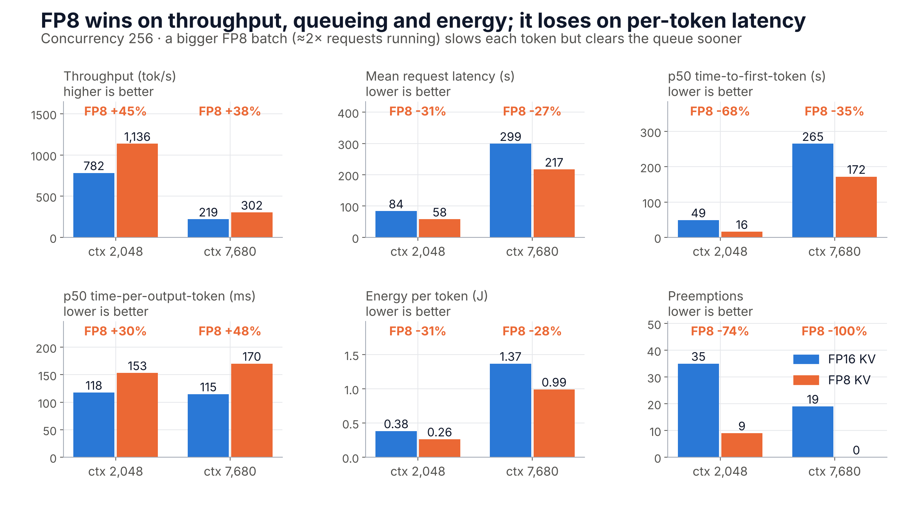
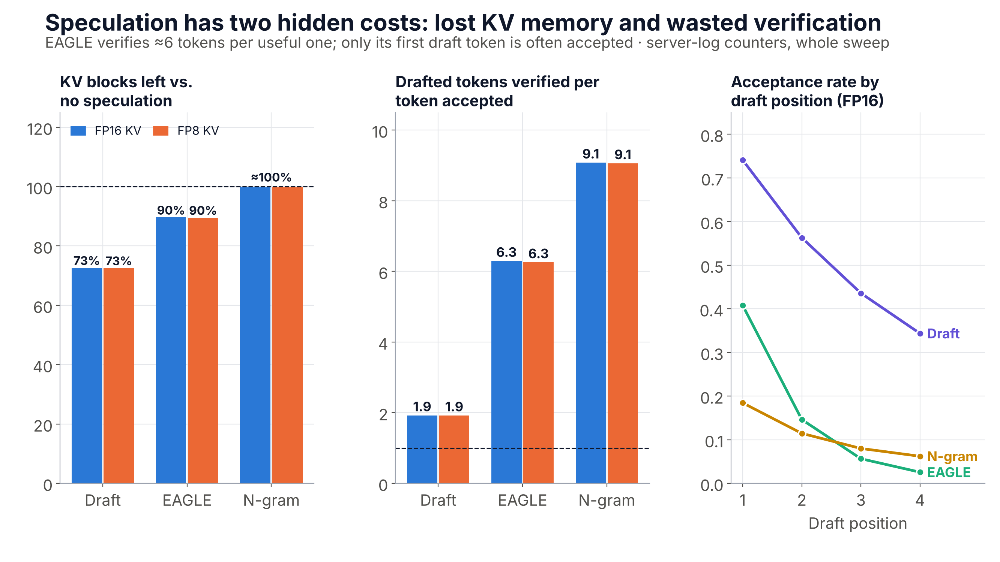
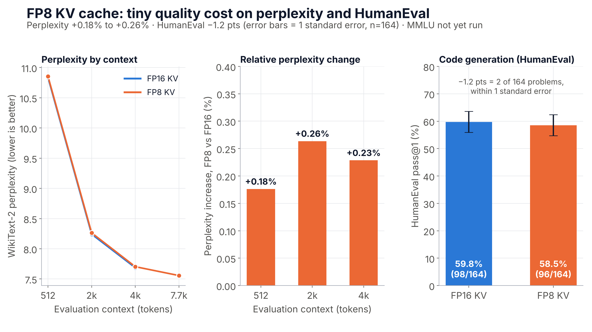
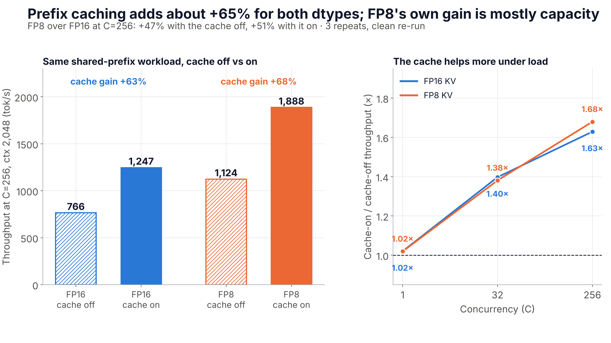

# Project Report: Balancing Memory and Compute in LLM Serving

**Course:** CS5903 Distributed AI Training | **Project ID:** 24 | **Group:** 9 (solo project)  
**Student:** Mridul Pant (cs24mtech15009), IIT Hyderabad  
**Repository:** https://github.com/mridulpant2010/llm_serving | **Final tag:** `cs5903-final-2026` | **Code and results commit:** `6c2b5d0` (the final tag sits a few commits later and only adds report wording, the server logs and the slide notes)  
**Companion documents:** `docs/Architecture_Decision_Records.md`, `README.md`, `evaluation/`  

## Executive summary

I measured how an FP8 KV cache and three speculative-decoding methods (draft model, EAGLE, N-gram) behave as load grows. The model is Llama-3-8B-Instruct, served by vLLM 0.32.0 on one NVIDIA RTX PRO 5000 Blackwell GPU. The analysis uses 221 measured rows: 80 from the first run (60 for FP16 versus FP8 under load and 20 for the FP16 N-gram sweep) and 141 from a clean re-run with 3 repeats on a second rented instance.

FP8 nearly doubles KV capacity (13,249 to 26,099 blocks). At concurrency C=256 it raises throughput by 38-45% at 2,048 and 7,680-token contexts. The cost is at most 0.26% in perplexity, and HumanEval does not change measurably (98 versus 96 of 164 problems). Speculation pays only at the lowest loads. With FP16 every method is at or above 1.0 at C=1 and C=4 (the draft model gives 1.50x and 1.35x), and by C=16 the gain is gone (draft model 1.03x, the others below 1.0). FP8 does not rescue speculation: the draft model's gain drops from 1.50x with FP16 to 1.03x with FP8 at C=1, and from C=16 upward the best setup is FP8 with no speculation (603, 1,009 and 1,122 tok/s at C=16, 64 and 256). A draft model takes 27% of the KV pool. The cache-off control shows that prefix caching adds 63% (FP16) and 68% (FP8) at C=256, so most of FP8's 47% advantage there is capacity and not caching.

What works: the harness, the sweeps, the analysis, and figures that regenerate from the raw data. What the re-run corrected: 64 rows of the first run had been rebuilt from `run.log`. 29 of the 32 comparable cells agree with the clean data within 5%, but the FP8 draft model at C=1, 4 and 16 was overstated by 10-19%, so the report uses clean rows only. What is not done: MMLU and a finer concurrency grid (sections 8 and 9).

## 1. Problem, scope and success criteria

The intended reader is an ML platform engineer who runs a shared vLLM-style endpoint and has to choose the KV-cache precision and whether to turn speculation on.

Decode is memory-bound, and two techniques attack that. An FP8 KV cache halves the cache footprint, so about twice as many requests fit. Speculative decoding spends spare compute to propose several tokens per step. The two can work against each other: bigger batches use up the spare compute that speculation needs, and a speculator's own weights take KV memory. The literature studies each technique alone. This project measures them together, on one GPU, under load.

In scope: one model (Llama-3-8B-Instruct, default precision), KV cache FP16 versus FP8 (E4M3), three speculators with k=4 proposed tokens, concurrency 1 to 256, contexts 512 to 7,680, 256 output tokens, quality checks (perplexity, HumanEval). Out of scope: multi-GPU and tensor parallelism, weight quantization, modifying vLLM internals, other models.

I rented GPU time by the hour. A budget of about 4 GPU-hours forced a reduced matrix in the first run, with 2 repeats instead of 3 and 5 concurrency levels instead of 9 (see the header of `configs/budget.yaml`). On submission day I rented a second instance and re-ran the speculation and prefix stages with 3 repeats (`configs/extra.yaml`).

The project tasks were T0 to T7: the framework (T0-T5, 24 automated tests), GPU setup (T6) and the sweeps (T7). The approved milestone IDs and the frozen acceptance-test wording are not recorded in this repository, and neither is any scored mentor feedback. The project counts as done when a clean checkout runs the budget matrix and produces the figures and tables in section 5. The target metrics are throughput (tok/s), TPOT, TTFT, request latency, preemptions, energy per token, perplexity change and pass@1.

## 2. Related work, baselines and alternatives

Related work. PagedAttention and vLLM (Kwon et al., SOSP 2023) removed most KV fragmentation. Speculative decoding (Leviathan et al., ICML 2023; Chen et al., 2023) keeps the target distribution exact. EAGLE (Li et al., ICML 2024) drafts at the feature level. FP8 formats are defined by Micikevicius et al. (2022). The roofline model (Williams et al., 2009) is used for sanity checks.

Approaches considered. (A) An analytic or queueing model: cheap, but it misses scheduler behavior such as preemption and recompute. (B) A simulator of the paged cache: used here only as a unit-tested helper. (C) Measurement of a real server (selected), plus a simple roofline model as a cross-check (§5.6).

Baseline. vLLM with FP16 KV cache and no speculation, on the same workload and concurrency.

Reused components. vLLM 0.32.0 (Apache-2.0); lm-evaluation-harness (MIT; 0.4.13 on the second instance, not recorded for the first); Llama-3-8B-Instruct and Llama-3.2-1B-Instruct (Llama community licences); `yuhuili/EAGLE-LLaMA3-Instruct-8B` (Apache-2.0 per its model card). I added the six-layer harness in `src/llm_serving/`, the configs, the analysis and the figure scripts in `evaluation/`.

## 3. Architecture and implementation

The harness treats vLLM as an unmodified black box (ADR-002). Six layers:

| Layer | Module(s) | Responsibility |
|---|---|---|
| 1 Orchestration | `config`, `orchestrator`, `cli` | Expands a YAML grid into runs; starts and stops servers; resumable (`--resume`) |
| 2 Workload | `workload`, `load_client` | Synthetic, WikiText-2 corpus and shared-prefix prompts; async streaming client; closed loop with C requests in flight |
| 3 System under test | vLLM server | PagedAttention, FP8 KV, speculative proposers |
| 4 Telemetry | `telemetry` | Per-token timestamps (TTFT, TPOT); `/metrics` deltas (preemptions, queue depth, acceptance); GPU power and memory |
| 5 Quality | `quality_eval`, `scripts/run_humaneval.py` | WikiText-2 perplexity through `prompt_logprobs`; HumanEval through lm-eval |
| 6 Analysis | `analysis`, `evaluation/` | Aggregates rows, computes speedups and the regime map |

Results are stored as append-only JSONL: `results.jsonl` has one row per cell and repeat, `quality.jsonl` holds the quality runs, and every server launch keeps its own log. Hugging Face access is needed for the Llama weights; the token comes from an environment variable (template in `.env.example`). The setup assumes a single-tenant GPU instance, the harness adds no authentication, and no secret is stored in the repository. The code is in `src/llm_serving/` and the design decisions are in ADR-002 to ADR-009.

## 4. Methodology and experiment setup

The study asks four questions. EQ1: how much does FP8 raise capacity and throughput under load? EQ2: at which concurrency does each speculator stop paying off, with FP16 and with FP8? EQ3: does FP8 measurably hurt quality? EQ4: how do FP8 and prefix caching combine?

Hardware and software: two rented instances of one NVIDIA RTX PRO 5000 Blackwell (48 GB class, 48,935 MiB reported), vLLM 0.32.0, Python 3.12, GPU compute capability sm_120, PyTorch 2.13.0+cu130 (CUDA 13.0). First instance: driver 580.105.08 (from the setup output of `scripts/setup_server.sh`, not saved to the repository). Second instance (re-run, 21 November 2026): driver 595.99.02, lm-evaluation-harness 0.4.13, repository commit `1b6df79`; its environment is saved in `results_extra/env.txt` and `results_extra/pip_freeze.txt`. The first run's FP16 no-speculation baseline and the re-run's agree within 2% at every concurrency (§5.6), so the two instances are treated as comparable.

Fixed settings: `gpu_memory_utilization` 0.90, `max_num_seqs` 256, seed 0, 256 output tokens, 16 warm-up requests discarded, at least 16 requests per level, CUDA graphs on; 2 repeats in the first run (`configs/budget.yaml`) and 3 in the re-run (`configs/extra.yaml`).

| Stage | Workload | KV | Speculation | Context | C | Rows used | Run |
|---|---|---|---|---|---|---|---|
| 1 capacity | synthetic | FP16, FP8 | none | 512, 2,048, 7,680 | 1, 4, 16, 64, 256 | 60 | first, 2 repeats |
| 3 speculation | WikiText-2 corpus | FP16 | none, draft, EAGLE | 2,048 | same | 45 | re-run, 3 repeats |
| 3 speculation | corpus | FP16 | N-gram, plus its none baseline | 2,048 | same | 20 | first, 2 repeats |
| 4 speculation | corpus | FP8 | none, N-gram, draft, EAGLE | 2,048 | same | 60 | re-run, 3 repeats |
| 5 prefix, cache on | shared 50% prefix | FP16, FP8 | none | 2,048 | 1, 32, 256 | 18 | re-run, 3 repeats |
| 5 prefix, cache off (control) | shared 50% prefix | FP16, FP8 | none | 2,048 | 1, 32, 256 | 18 | re-run, 3 repeats |
| Quality | WikiText-2 windows, HumanEval | FP16, FP8 | none | 512-7,680 | n/a | 7 + 2 | first |

Speculators: draft model Llama-3.2-1B-Instruct, EAGLE head, and N-gram prompt lookup (2 to 4 tokens), all with k=4. Metrics: throughput (tokens per second), TPOT p50, TTFT, request latency (concurrency divided by request rate, Little's law), preemptions, energy per token, perplexity, pass@1. Speedup is computed per repeat and reported with its range.

Scripts: `scripts/run_experiments.sh budget` (first run), `scripts/collect_remaining.sh rerun` and `prefix` (re-run), then `python evaluation/merge_results.py`, `python evaluation/make_analysis.py results_final evaluation/output` and `python evaluation/make_regime_map.py results_final evaluation/output`.

## 5. Results, observations and analysis

Every number below is recomputed by script from `results_final/results.jsonl`, which `evaluation/merge_results.py` builds from the first run (`results_budget/`) and the re-run (`results_extra/`). Stage 1 and the FP16 N-gram sweep (with its baseline) are the first run's raw rows. Stage 3 (draft model and EAGLE), Stage 4 and Stage 5 come from the clean re-run. The 64 rows that had been rebuilt from `run.log` are not used (§8); they are compared with the re-run in `results_final/rebuilt_vs_rerun.csv`. Failed launches (`status` not `ok`) are dropped. Tables are in `evaluation/output/comparison_tables.xlsx`.

### 5.1 FP8 under load (EQ1)

The KV pool grows from 13,249 blocks (211,984 tokens) to 26,099 blocks (417,584 tokens): 1.97x. Analytic concurrency capacity at contexts 512, 2,048 and 7,680 rises from 276, 92, 26 to 543, 181, 52 requests.

| At C=256 | ctx 2,048 FP16 | FP8 | ctx 7,680 FP16 | FP8 |
|---|---|---|---|---|
| Throughput (tok/s) | 782 | **1,137** (+45%) | 219 | **302** (+38%) |
| Mean request latency (s) | 83.8 | 57.7 (-31%) | 299 | 217 (-27%) |
| TTFT p50 (s) | 48.9 | 15.9 (-68%) | 265 | 172 (-35%) |
| TTFT p99 (s) | 73.7 | 51.5 (-30%) | n/a | n/a |
| Preemptions | 35 | 9 | 19 | **0** |
| Energy (J/token) | 0.383 | 0.263 (-31%) | 1.37 | 0.99 (-28%) |
| TPOT p50 (ms) | 118 | 153 (+30%) | 115 | 170 (+48%) |

Peak-to-peak at ctx 2,048 the gain is +33% (FP16 peaks at 857 tok/s at C=64; FP8 reaches 1,137 at C=256). At ctx 512 the gain at C=256 is +20% (2,840 to 3,410). FP8 runs a much larger batch (193 requests running versus 100 at ctx 2,048), so each token is slower (TPOT up) while requests finish sooner. FP16 throughput falls from C=64 to C=256 (857 to 782) when preemptions begin.

### 5.2 Speculation versus concurrency (EQ2)

Throughput speedup against the same-dtype baseline (ctx 2,048, corpus; 3 repeats, 2 for FP16 N-gram; the min-max range of each cell is in the workbook):

| C | Draft FP16 | Draft FP8 | EAGLE FP16 | EAGLE FP8 | N-gram FP16 | N-gram FP8 |
|---|---|---|---|---|---|---|
| 1 | **1.50** | 1.03 | 1.04 | 1.11 | 1.12 | 1.22 |
| 4 | **1.35** | 1.05 | 1.03 | 1.06 | 1.14 | 1.13 |
| 16 | 1.03 | 0.97 | 0.90 | 0.96 | 0.93 | 0.98 |
| 64 | 0.88 | 0.85 | 0.81 | 0.84 | 0.80 | 0.85 |
| 256 | 0.98 | 0.80 | 0.87 | 0.82 | 0.82 | 0.82 |

The pattern is as follows. At C=1 every method helps, though the FP8 draft model only marginally (1.03). At C=4 most still do, except where the repeat range reaches 1.0 (FP16 EAGLE, the FP8 draft model and FP8 EAGLE). The FP16 draft model is at parity by C=16, and every method loses from C=64 upward. The best setup at each C is: C=1 FP16 with the draft model at 106.7 tok/s (+47% over the FP8 baseline); C=4 FP16 with the draft model at 305.9 (+29%); and at C=16, 64 and 256 FP8 without speculation (603, 1,009 and 1,122). I read this as five measured points and not as a general rule. I do not headline interpolated crossover points, because with 5 levels they move with the interpolation rule (ADR-006).

FP8 does not rescue speculation. The rebuilt rows of the first run had suggested that FP8 slightly widened the break-even (FP8 draft model 1.28, 1.27 and 1.07 at C=1, 4 and 16). The clean re-run does not support that. The FP8 draft model gives 1.03, 1.05 and 0.97, against 1.50, 1.35 and 1.03 with FP16. Acceptance is the same under both precisions (52%), so the difference is in the cost per step and not in the quality of the proposals. One possible reason is that verifying several tokens against an FP8 cache is slower in this vLLM build, but I did not test that. EAGLE and N-gram gain a little more with FP8 at C=1 (1.11 and 1.22 versus 1.04 and 1.12); I did not look into that either.

Why speculation fades: a weaker proposer wastes more verification work. Drafted tokens per accepted token over the whole sweep are: draft model 1.9 (acceptance 52%), EAGLE 6.3 (16%), N-gram 9.1 (11%). EAGLE per-position acceptance is 0.41, 0.15, 0.06, 0.03. At high load the verify work competes with a batch that already saturates compute.

The speculator also shrinks the KV pool. Blocks compared with no speculation: draft model 9,617 FP16 and 18,922 FP8 (-27%), EAGLE 11,869 and 23,362 (-10%), N-gram 13,210 and 26,024 (-0.3%); the re-run reproduces the first run's pool sizes to within 7 blocks. This is why, at C=256, per-token latency (TPOT) looks better with the draft model (TPOT speedup 1.44x with FP16 and 2.15x with FP8) while throughput is worse (0.98x and 0.80x). A smaller pool admits fewer requests at once.

### 5.3 Quality (EQ3)

| Context | Tokens scored | FP16 perplexity | FP8 perplexity | Change |
|---|---|---|---|---|
| 512 | 32,704 | 10.8357 | 10.8548 | +0.18% |
| 2,048 | 131,008 | 8.2412 | 8.2629 | +0.26% |
| 4,096 | 262,080 | 7.6858 | 7.7034 | +0.23% |
| 7,680 | 491,456 | failed | 7.5564 | no pair |

The FP16 run at 7,680 crashed and its cause was not diagnosed, so there is no paired result there. HumanEval (164 problems, pass@1): FP16 59.8% (98/164, standard error 3.8) versus FP8 58.5% (96/164, standard error 3.9). The gap is 2 problems. At this sample size, a real difference of several points could not be ruled out, so I claim "no measurable loss" and not equivalence. MMLU was not run.

### 5.4 Prefix caching (EQ4)

The re-run adds the missing cache-off control on the same shared-prefix workload (3 repeats):

| C=256, tok/s | Cache off | Cache on | Cache gain | Preemptions off / on |
|---|---|---|---|---|
| FP16 | 766 | 1,247 | +63% | 35 / 49 |
| FP8 | 1,124 | 1,888 | +68% | 8 / 0 |

FP8 over FP16 is +47% with the cache off and +51% with it on, so most of FP8's advantage is capacity, and the cache adds a similar ~65% to both. The cache helps more under load (+40% and +38% at C=32, about +2% at C=1). The first run's rebuilt prefix rows (1,264 and 1,906 tok/s) agree with the clean values within 1.4%. With the cache on, FP16 has 49 preemptions, more than with it off. Cached blocks probably compete with running requests for the same pool, but I did not check that.

### 5.5 Energy

GPU power is nearly flat (about 299 W in Stage 1; 218-300 W across the re-run), so energy per token follows throughput: at ctx 512, C=256 it is 0.087 J/token with FP8 versus 0.105 with FP16.

### 5.6 Cross-checks

At C=1, a bandwidth model (16.06 GB of weights at about 1.2 TB/s plus KV reads) predicts 13.56 and 14.18 ms per token at ctx 2,048 and 7,680 for FP16; measured 13.57 and 14.16 ms. The FP8 predictions are within about 1%. Analytic KV capacity matches the largest observed running batch within 9%. Prefill ceilings at C=1 are 5,094, 1,498 and 364 tok/s at contexts 512, 2,048 and 7,680.

The re-run's FP16 no-speculation baseline at C=1, 4, 16, 64 and 256 (71.0, 226.4, 564.9, 844.6, 772.1 tok/s) agrees with the first run's within 2% at every level, and the FP8 baseline at C=256 (1,122) with the first run's Stage 1 value (1,137) within 1.4%. Of 32 cells where the rebuilt rows can be compared with clean data, 29 agree within 5% (median difference 1.2%). The three that do not are the FP8 draft model at C=1, 4 and 16, where the rebuilt rows were 19%, 16% and 10% too high (92.2, 299.5 and 651.0 against 74.4, 250.5 and 585.2 tok/s). The cause of that gap is not known.

### 5.7 Failure and edge cases

| Case | Observed |
|---|---|
| Memory exhaustion (FP16, C=256, ctx 2,048) | 35 preemptions, TTFT p99 73.7 s, throughput below its C=64 value |
| Long context (FP16, C=256, ctx 7,680) | 19 preemptions; FP8 has 0 |
| Failed launches | 4 Stage-1 launches failed at startup (`max_model_len` 8,464 greater than the model's 8,192 limit); the cells were re-run, so all 60 Stage-1 rows exist. On the re-run instance, 7 launches failed first (disk full while loading weights); their `server_failed` rows stay in `results_extra/results.jsonl` and are excluded by the merge step |
| FP16 perplexity at 7,680 | run crashed; cause undiagnosed |

## 8. Current state, limitations and risks

| Area | Working | Partial | Missing |
|---|---|---|---|
| Harness, resume, mock backend, 24 tests | yes | | |
| Stage 1 capacity (60 runs) | yes | 2 repeats | |
| Speculation sweeps (Stages 3, 4) | clean re-run: all telemetry real, 3 repeats | FP16 N-gram from the first run, 2 repeats; 5 levels | finer grid |
| Quality | perplexity, HumanEval | no FP16 at 7,680 | MMLU |
| Prefix caching | cache off and on, FP16 and FP8, 3 repeats | one context length | |

Known defects and risks:
1. The first run's rebuilt rows (resolved by the re-run, kept for transparency). The `results.jsonl` downloaded from the first Vast.ai instance was truncated at 92 lines, although all stages had finished. The 64 missing rows (Stage 3 draft model at C=256 (2 rows), Stage 3 EAGLE (10), Stage 4 (40), Stage 5 (12)) were rebuilt from `run.log` and `summary.json`; only throughput, TPOT p50, KV blocks, preemptions and mean acceptance were real, and TTFT, power, utilisation, memory and timestamps were placeholders (TTFT 500/1,000/1,500 ms, power 298 W). They remain in `results_budget/results.jsonl` and are not used in any figure or table. All of Stages 3 (draft model, EAGLE), 4 and 5 were re-measured on 21 November 2026 with real telemetry (no placeholder rows; TTFT and power vary). Comparison (`rebuilt_vs_rerun.csv`): 29 of 32 cells agree within 5%; the FP8 draft model at C=1, 4 and 16 was 19%, 16% and 10% too high in the rebuilt rows. That error is why the earlier claim that FP8 widens the break-even for speculation was withdrawn.
2. Two instances. Stage 1 and the FP16 N-gram sweep come from the first instance (driver 580.105.08), the rest from the second (595.99.02). The FP16 baselines agree within 2%, but the instances are not identical. The FP16 N-gram sweep has 2 repeats and is paired with the first run's own baseline.
3. Low statistical power. 3 repeats (2 for Stage 1 and FP16 N-gram) and 5 concurrency levels: speedups are reported with their range, and crossover points are not claimed. The FP8 draft model's gain at C=4 and the EAGLE gains at C=4 touch 1.0.
4. Unexplained results. The FP8 draft model is much slower than the FP16 draft model at C=1 (74 versus 107 tok/s) with equal acceptance; the cause is not tested. The FP16 perplexity run at 7,680 tokens crashed; the cause is not diagnosed.
5. Reproducibility gaps. The first instance's setup output (CUDA, PyTorch versions) was not saved; the second instance's is. The `vastai` SSH private key was committed to the repository and must be revoked; it is unrelated to the results. Status at submission: removed from tracking; revoking it at the provider is still to be done by the owner (`docs/open_issues.md`, issue 5).
6. No GitHub issues exist yet for the open items below. The text for them is drafted in `docs/open_issues.md`.

How much weight the results can bear:

| Claim | Basis | Confidence |
|---|---|---|
| FP8 gives 1.97x KV capacity and +38-45% throughput at C=256 | Stage 1, raw rows; the re-run reproduces the pool size (26,092 versus 26,099 blocks) and the FP8 baseline within 1.4%; roofline cross-check within 1-3% | Strong |
| Draft model takes 27% of the KV pool (EAGLE 10%, N-gram 0.3%) | Block counts from both runs' server logs, identical within 7 blocks | Strong |
| FP8 costs at most 0.26% perplexity | Raw, three paired lengths | Strong for language modelling; not shown for knowledge tasks (no MMLU) |
| No measurable HumanEval change | 98 versus 96 of 164, raw | Limited: n=164 cannot rule out a difference of several points |
| Speculation pays only at low C; from C=16 FP8 with no speculation wins | Clean re-run, 3 repeats, real telemetry; same direction for all methods and both dtypes; FP16 N-gram from the first run | Strong for the direction; exact break-even is only known to the grid (1, 4, 16, 64, 256) |
| FP8 weakens the draft model's gain (1.50x to 1.03x at C=1) | Clean re-run, ranges do not overlap at C=1 | Moderate: cause not tested, one model pair |
| Prefix caching adds about 65% for both dtypes; FP8's advantage is mostly capacity | Clean re-run with cache-off control, 3 repeats, ranges under 1% | Strong for this workload (50% shared prefix, ctx 2,048) |
| Energy per token tracks throughput | Stage 1 raw rows; power nearly flat at about 299 W | Moderate: one GPU, board power sensor |

## 9. Way forward

| # | Task | Status | Starting point | Done when |
|---|---|---|---|---|
| 1 | Run full MMLU for FP16 and FP8 | **open** | `scripts/collect_remaining.sh mmlu` | Two result files; accuracy difference reported with a confidence interval |
| 2 | Cache-off control for prefix caching | done 21 Nov 2026 | stage `stage5c_prefix_control` | see §5.4 |
| 3 | Clean re-run of Stages 3 and 4 with 3 repeats | done 21 Nov 2026 | stages `stage4r_spec_fp8`, `stage3r_spec_fp16` | see §5.2 and §5.6 |
| 4 | Finer grid at C=8, 32, 128 | **open** | stages `stage3b_fine_fp16`, `stage3b_fine_fp8` | The concurrency where speedup crosses 1.0 is located within one grid step, per method and dtype |
| 5 | Find the source of the placeholder telemetry in the first run | open | `src/llm_serving/orchestrator.py` and `telemetry.py` | A new test fails if TTFT or power is constant across a sweep |
| 6 | Test why the FP8 draft model is slow at low C | open | FP8 draft versus FP16 draft at C=1, and one profiler trace | The slow step is identified, or the effect is shown to disappear in another vLLM version |

## 10. Contributions, AI use and attribution

This was a solo project. I designed the study, chose the metrics and stages, ran the sweeps and the quality evaluations on the rented GPU instances, directed and reviewed the AI-written code, and interpreted the results. The code itself was written with heavy AI assistance (below), and I am responsible for understanding and explaining it. Commit history: https://github.com/mridulpant2010/llm_serving/commits/main.

AI use:

1. Google Antigravity (Gemini): created or edited every module in `src/llm_serving/` (the six-layer harness, `kv_cache.py`, `paged_attention.py`, `plotting.py`, `run_benchmark.py`), the tests (`tests/`), the scripts, the configs `experiments.yaml`, `budget.yaml` and `pilot.yaml`, the first drafts of the README, the first report and ADRs, and the rebuild of the 64 truncated result rows from `run.log` (§8; later superseded by the re-run).
2. Claude (Anthropic): `configs/extra.yaml` and `scripts/collect_remaining.sh`, the analysis scripts in `evaluation/` (including `merge_results.py`), the charts and comparison tables, the deck update, an audit of the first report and ADRs (which corrected wrong figures), the comparison of the re-run with the first run, and the rewrite of the report, ADRs and README. I ran the re-run on the rented GPU and supplied the results.

How it was checked: The 24 automated tests; every number in §5 is recomputed by script from `results.jsonl`; the audit compared the first drafts' claims with the raw data and corrected them (preemption counts, TTFT p99, GPU model, CUDA and PyTorch versions, overstated quality and prefix-cache claims, and the undisclosed row reconstruction). Limits of that checking: the harness code was reviewed by running it, not line by line by an independent reviewer.

Third-party assets: vLLM 0.32.0 (Apache-2.0); lm-evaluation-harness (MIT); Meta Llama 3 and Llama 3.2 weights (Llama community licences); EAGLE head (Apache-2.0); WikiText-2 (CC BY-SA 3.0 and GFDL, per its dataset card).

## 11. Operational handover

This repository is a benchmark harness plus the measured results of FP8 KV cache versus speculative decoding on Llama-3-8B-Instruct. It is a research artefact, not a service: nothing runs in production, and nothing needs to be kept alive.

To run it without a GPU (about 5 minutes): `git clone https://github.com/mridulpant2010/llm_serving.git`, create a virtual environment, `pip install -e ".[dev]"`, then `pytest` (24 tests, mock backend). This checks the harness logic and the full pipeline end to end.

To regenerate every figure and table from the saved data (about 1 minute, no GPU): `python evaluation/merge_results.py results_budget results_extra results_final`, then `python evaluation/make_analysis.py results_final evaluation/output` and `python evaluation/make_regime_map.py results_final evaluation/output`.

To re-measure on a GPU (about 3 hours, about $2.50 on a rented RTX PRO 5000 class instance):
1. Rent an instance with 48 GB of VRAM and at least 100 GB of disk (the Llama weights and caches need about 30 GB, and a 32 GB disk fills up).
2. `export HF_TOKEN=...` (the Llama-3 weights are gated), then `bash scripts/setup_server.sh`. It pins vLLM 0.32.0 and prints the versions; check that it says `vllm 0.32.0`.
3. Inside `tmux` or `nohup`: `./scripts/collect_remaining.sh rerun && ./scripts/collect_remaining.sh prefix`. The orchestrator is resumable, so re-running the same command skips finished rows. Then `./scripts/collect_remaining.sh verify` and `pack`.
4. Download `results_extra.tgz`, compare its checksum with the `.sha256` file, then destroy the instance and revoke the token.

Where things are: `src/llm_serving/` is the code; `configs/` experiment grids (`budget.yaml` first run, `extra.yaml` re-run); `results_budget/` first run; `results_extra/` re-run with `env.txt`, `pip_freeze.txt`, `run.log` and server logs; `results_final/` merged analysis dataset; `evaluation/` analysis scripts and `output/` charts; `docs/` this report, the ADR log, figures and slides.

Secrets and access: the only secret is the Hugging Face token, read from the `HF_TOKEN` environment variable (template in `.env.example`); it is never stored in the repository. An SSH private key for the rented GPU provider was committed early in the project and removed from tracking; it remains in git history, so it must be treated as compromised and revoked at the provider (§8, item 5).

Cost and infrastructure: there is no standing infrastructure. GPU time is rented by the hour from Vast.ai; the first run used about 4 GPU-hours and the re-run about 2 to 3.

Known issues you inherit: the first run's `results.jsonl` contains 64 rebuilt rows that are not used by any analysis (§8); failed launches appear as `server_failed` rows in `results_extra/results.jsonl` and are dropped by the merge step; the FP8 draft-model slowdown at low load is unexplained; MMLU and the finer concurrency grid are not run. The open tasks are in §9 and in `docs/open_issues.md`.

Owner: Mridul Pant (cs24mtech15009), solo project, IIT Hyderabad. Most code was written with AI assistance (§10), so read `tests/` and `docs/Architecture_Decision_Records.md` before changing the harness.

## References

1. Kwon et al. Efficient Memory Management for LLM Serving with PagedAttention. SOSP 2023.
2. Leviathan, Kalman, Matias. Fast Inference from Transformers via Speculative Decoding. ICML 2023.
3. Chen et al. Accelerating LLM Decoding with Speculative Sampling. arXiv:2302.01318, 2023.
4. Li et al. EAGLE: Speculative Sampling Requires Rethinking Feature Uncertainty. ICML 2024.
5. Micikevicius et al. FP8 Formats for Deep Learning. arXiv:2209.05433, 2022.
6. Williams, Waterman, Patterson. Roofline. Communications of the ACM, 2009.

Appendix: raw data in `results_budget/` (first run) and `results_extra/` (re-run, with `env.txt`, `pip_freeze.txt`, `run.log`, `server_logs/`); the merged analysis dataset in `results_final/`; regenerate everything with `evaluation/README.md`.
