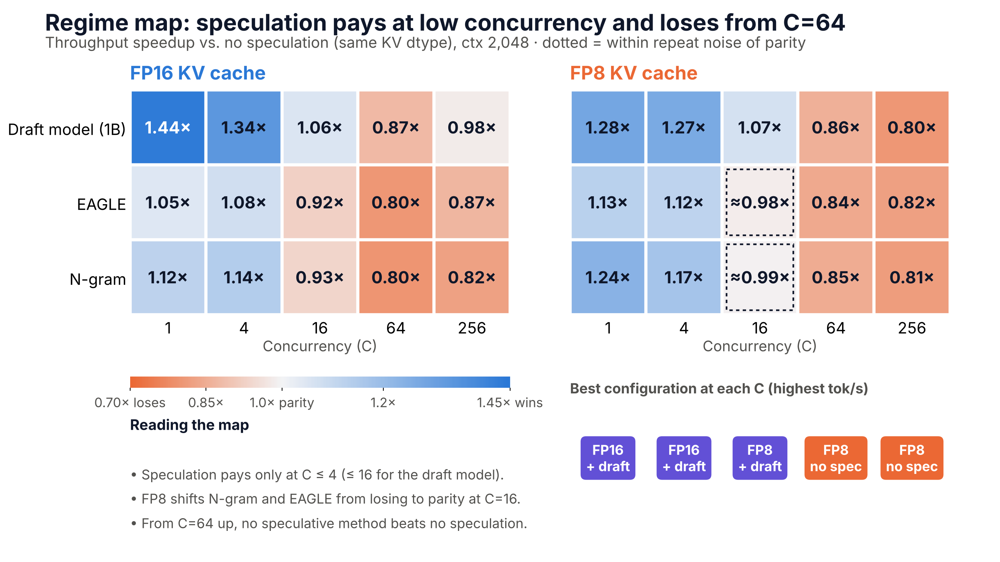

# Project Report: Balancing Memory and Compute in LLM Serving

**Course:** CS5903 Distributed AI Training | **Project ID:** 24 | **Group:** 9 (solo project)  
**Student:** Mridul Pant (cs24mtech15009), IIT Hyderabad  
**Repository:** https://github.com/mridulpant2010/llm_serving | **Final tag:** `cs5903-final-2026` | **Commit:** `[FILL: SHA of the tagged commit]`  
**Companion documents:** `docs/Architecture_Decision_Records.md`, `README.md`, `evaluation/`  

## Executive summary

We measured how an FP8 KV cache and three speculative-decoding methods (draft model, EAGLE, N-gram) interact as load grows. The target is Llama-3-8B-Instruct, served by vLLM 0.32.0 on one NVIDIA RTX PRO 5000 Blackwell GPU (152 successful runs, 2 repeats each). FP8 almost doubles KV capacity (13,249 to 26,099 blocks). At concurrency C=256 it raises throughput by 38-45% at 2,048 and 7,680-token contexts, at a perplexity cost of at most 0.26% and no measurable HumanEval change (98 versus 96 of 164 problems). Speculation pays only at low concurrency: up to C=4 for every method, and up to about C=16 for the draft model. From C=64, FP8 without speculation is the best configuration. A draft model costs 27% of the KV pool. **Working:** the harness, the sweeps, the analysis, and figures that regenerate from raw data. **Partial:** 64 of 156 result rows were rebuilt from `run.log` (placeholder telemetry); 2 repeats; 5 concurrency levels. **Not done:** MMLU, a cache-off prefix control, and a finer concurrency grid, because GPU credit ran out (§8, §9).

## 1. Problem, scope and success criteria

**Actors.** ML platform engineers who run shared vLLM-style endpoints and choose the KV-cache precision and whether to enable speculation.

**Problem.** Decode is memory-bound. Two levers address it. FP8 KV cache halves the cache footprint, so about twice as many requests fit. Speculative decoding spends spare compute to propose several tokens per step. They can collide: bigger batches use up the spare compute that speculation needs, and a speculator's own weights take KV memory. Each lever is studied alone in the literature. Their interaction under load, on one GPU, is what this project measures.

**In scope.** One model (Llama-3-8B-Instruct, default precision), KV cache FP16 versus FP8 (E4M3), three speculators with k=4 proposed tokens, concurrency 1 to 256, contexts 512 to 7,680, 256 output tokens, quality checks (perplexity, HumanEval). **Out of scope.** Multi-GPU and tensor parallelism, weight quantization, modifying vLLM internals, other models.

**Assumptions and constraints.** One GPU instance rented by the hour. A budget of about 4 GPU-hours forced a reduced matrix: 2 repeats instead of 3 and 5 concurrency levels instead of 9 (`configs/budget.yaml` header).

**Milestones and acceptance.** Framework T0-T5 (24 automated tests), GPU setup T6, sweeps T7. The approved milestone IDs and the frozen acceptance-test wording are not recorded in this repository; the project tasks are T0-T7. No scored mentor feedback is recorded in this repository either. **Done when:** a clean checkout runs the budget matrix and produces the figures and tables in §5. **Target metrics:** throughput (tok/s), TPOT, TTFT, request latency, preemptions, energy per token, perplexity change, pass@1.

## 2. Related work, baselines and alternatives

**Related work.** PagedAttention and vLLM (Kwon et al., SOSP 2023) removed most KV fragmentation. Speculative decoding (Leviathan et al., ICML 2023; Chen et al., 2023) keeps the target distribution exact. EAGLE (Li et al., ICML 2024) drafts at the feature level. FP8 formats are defined by Micikevicius et al. (2022). The roofline model (Williams et al., 2009) is used for sanity checks.

**Approaches considered.** (A) An analytic or queueing model: cheap, but it misses scheduler behavior such as preemption and recompute. (B) A simulator of the paged cache: used here only as a unit-tested helper. (C) **Measurement of a real server (selected)**, plus a simple roofline model as a cross-check (§5.6).

**Baseline.** vLLM with FP16 KV cache and no speculation, on the same workload and concurrency.

**Reused components.** vLLM 0.32.0 (Apache-2.0); lm-evaluation-harness (MIT; version not recorded); Llama-3-8B-Instruct and Llama-3.2-1B-Instruct (Llama community licences); `yuhuili/EAGLE-LLaMA3-Instruct-8B` (Apache-2.0 per its model card). **Added by the team:** the six-layer harness in `src/llm_serving/`, the configs, the analysis and the figure scripts in `evaluation/`.

## 3. Architecture and implementation

The harness treats vLLM as an unmodified black box (ADR-002). Six layers:

| Layer | Module(s) | Responsibility |
|---|---|---|
| 1 Orchestration | `config`, `orchestrator`, `cli` | Expands a YAML grid into runs; starts and stops servers; resumable (`--resume`) |
| 2 Workload | `workload`, `load_client` | Synthetic, WikiText-2 corpus and shared-prefix prompts; async streaming client; closed loop with C requests in flight |
| 3 System under test | vLLM server | PagedAttention, FP8 KV, speculative proposers |
| 4 Telemetry | `telemetry` | Per-token timestamps (TTFT, TPOT); `/metrics` deltas (preemptions, queue depth, acceptance); GPU power and memory |
| 5 Quality | `quality_eval`, `scripts/run_humaneval.py` | WikiText-2 perplexity through `prompt_logprobs`; HumanEval through lm-eval |
| 6 Analysis | `analysis`, `evaluation/` | Aggregates rows, computes speedups and the regime map |

**Data.** Append-only JSONL: `results.jsonl` (one row per cell and repeat), `quality.jsonl`, server logs per launch. **Dependencies.** Hugging Face access for the Llama weights (token via environment variable, template in `.env.example`). **Trust boundary.** Single-tenant GPU instance; the harness adds no authentication, and no secret is stored in the repository. Source: `src/llm_serving/`. Decisions: ADR-002 to ADR-008.

## 4. Methodology and experiment setup

**Questions.** EQ1: how much does FP8 raise capacity and throughput under load? EQ2: at which concurrency does each speculator stop paying off, with FP16 and with FP8? EQ3: does FP8 measurably hurt quality? EQ4: how do FP8 and prefix caching combine?

**Hardware and software.** One NVIDIA RTX PRO 5000 Blackwell (48 GB class, inferred from the KV-pool size), vLLM 0.32.0, Python 3.12. CUDA 13.0 (driver 580.105.08), PyTorch 2.13.0+cu130, GPU compute capability sm_120. These come from the setup output printed by `scripts/setup_server.sh` on the instance (`vllm 0.32.0 | torch 2.13.0+cu130 | ... | sm (12, 0)`); that output was not saved to the repository. lm-evaluation-harness version: not recorded (`requirements.txt` pins `>=0.4.3`).

**Fixed settings.** `gpu_memory_utilization` 0.90, `max_num_seqs` 256, seed 0, 256 output tokens, 16 warm-up requests discarded, at least 16 requests per level, CUDA graphs on, 2 repeats (`configs/budget.yaml`).

| Stage | Workload | KV | Speculation | Context | C | Runs |
|---|---|---|---|---|---|---|
| 1 capacity | synthetic | FP16, FP8 | none | 512, 2,048, 7,680 | 1, 4, 16, 64, 256 | 60 |
| 3 speculation | WikiText-2 corpus | FP16 | none, N-gram, draft, EAGLE | 2,048 | same | 40 |
| 4 speculation | corpus | FP8 | same four | 2,048 | same | 40 |
| 5 prefix | shared 50% prefix | FP16, FP8 | none | 2,048 | 1, 32, 256 | 12 |
| Quality | WikiText-2 windows, HumanEval | FP16, FP8 | none | 512-7,680 | n/a | 7 + 2 |

Speculators: draft model Llama-3.2-1B-Instruct, EAGLE head, and N-gram prompt lookup (2 to 4 tokens), all with k=4. **Metrics.** Throughput (tokens per second), TPOT p50, TTFT, request latency (concurrency divided by request rate, Little's law), preemptions, energy per token, perplexity, pass@1. Speedup is computed per repeat and reported with its range. **Scripts.** `scripts/run_experiments.sh budget`, then `python evaluation/make_analysis.py results_budget evaluation/output`.

## 5. Results, observations and analysis

Every number below is recomputed from `results_budget/results.jsonl` by `evaluation/make_analysis.py`. **Data source:** rows 1-92 are raw harness output (Stage 1 and most of Stage 3). Rows 93-156 (Stage 3 draft model at C=256, Stage 3 EAGLE, all of Stage 4, all of Stage 5) were rebuilt from `run.log`, so for them only throughput, TPOT p50, KV blocks, preemptions and mean acceptance are measured values (§8). Tables are in `evaluation/output/comparison_tables.xlsx`.

### 5.1 FP8 under load (EQ1)

The KV pool grows from 13,249 blocks (211,984 tokens) to 26,099 blocks (417,584 tokens): **1.97x**. Analytic concurrency capacity at contexts 512, 2,048 and 7,680 rises from 276, 92, 26 to 543, 181, 52 requests.

| At C=256 | ctx 2,048 FP16 | FP8 | ctx 7,680 FP16 | FP8 |
|---|---|---|---|---|
| Throughput (tok/s) | 782 | **1,137** (+45%) | 219 | **302** (+38%) |
| Mean request latency (s) | 83.8 | 57.7 (-31%) | 299 | 217 (-27%) |
| TTFT p50 (s) | 48.9 | 15.9 (-68%) | 265 | 172 (-35%) |
| TTFT p99 (s) | 73.7 | 51.5 (-30%) | n/a | n/a |
| Preemptions | 35 | 9 | 19 | **0** |
| Energy (J/token) | 0.383 | 0.263 (-31%) | 1.37 | 0.99 (-28%) |
| TPOT p50 (ms) | 118 | 153 (+30%) | 115 | 170 (+48%) |

Peak-to-peak at ctx 2,048 the gain is +33% (FP16 peaks at 857 tok/s at C=64; FP8 reaches 1,137 at C=256). At ctx 512 the gain at C=256 is +20% (2,840 to 3,410). FP8 runs a much larger batch (193 requests running versus 100 at ctx 2,048), so each token is slower (TPOT up) while requests finish sooner. FP16 throughput falls from C=64 to C=256 (857 to 782) when preemptions begin.

### 5.2 Speculation versus concurrency (EQ2)

Throughput speedup against the same-dtype baseline (ctx 2,048, corpus; 2 repeats, the ranges are in the workbook):

| C | Draft FP16 | Draft FP8 | EAGLE FP16 | EAGLE FP8 | N-gram FP16 | N-gram FP8 |
|---|---|---|---|---|---|---|
| 1 | 1.44 | 1.28 | 1.05 | 1.13 | 1.12 | 1.24 |
| 4 | 1.34 | 1.27 | 1.08 | 1.12 | 1.14 | 1.17 |
| 16 | 1.05 | 1.07 | 0.92 | 0.98 | 0.93 | 0.99 |
| 64 | 0.87 | 0.86 | 0.80 | 0.84 | 0.80 | 0.85 |
| 256 | 0.98* | 0.80 | 0.87 | 0.82 | 0.82 | 0.81 |

\*Rebuilt row, treat with caution (see §8). **Reading:** every method helps at C=1 and C=4, the draft model stays slightly positive to C=16, and all methods lose from C=64 upward. Best configuration at each C: C=1 FP16+draft 101.5 tok/s (+41% over the FP8 baseline); C=4 FP16+draft 301 (+28%); C=16 FP8+draft 651 (+7%); **C=64 and 256 FP8 without speculation (1,024 and 1,136)**. This is an interpretation of five measured points, not a general rule. We do not headline interpolated crossover points: with 5 levels and 2 repeats they move with the interpolation rule (ADR-006).

**Why speculation fades.** Verification waste grows with a weaker proposer. Drafted tokens per accepted token over the whole sweep: draft model 1.9 (acceptance 52%), EAGLE 6.3 (16%), N-gram 9.1 (11%). EAGLE per-position acceptance is 0.41, 0.15, 0.06, 0.03. At high load the verify work competes with a batch that already saturates compute.

**KV-pool tax of the speculator.** Blocks versus no speculation: draft model 9,618 FP16 and 18,924 FP8 (-27%), EAGLE 11,869 and 23,361 (-10%), N-gram 13,210 and 26,027 (-0.3%). This explains why, at C=256, per-token latency (TPOT) looks better with the draft model while throughput is worse: a smaller pool admits fewer requests at once.

### 5.3 Quality (EQ3)

| Context | Tokens scored | FP16 perplexity | FP8 perplexity | Change |
|---|---|---|---|---|
| 512 | 32,704 | 10.8357 | 10.8548 | +0.18% |
| 2,048 | 131,008 | 8.2412 | 8.2629 | +0.26% |
| 4,096 | 262,080 | 7.6858 | 7.7034 | +0.23% |
| 7,680 | 491,456 | failed | 7.5564 | no pair |

The FP16 run at 7,680 crashed and its cause was not diagnosed, so there is no paired result there. **HumanEval** (164 problems, pass@1): FP16 59.8% (98/164, standard error 3.8) versus FP8 58.5% (96/164, standard error 3.9). The gap is 2 problems. At this sample size, a real difference of several points could not be ruled out, so we claim "no measurable loss", not equivalence. **MMLU was not run.**

### 5.4 Prefix caching (EQ4)

At C=256 with caching on, FP8 reaches 1,906 tok/s versus 1,264 for FP16 (+51%): a controlled comparison. The effect of the cache itself is **not measured**: no cache-off run exists on the shared-prefix workload. The corpus-workload baselines (780 and 1,136 tok/s) are a different workload and are not comparable.

### 5.5 Energy

GPU power is nearly flat (about 299 W), so energy per token follows throughput: at ctx 512, C=256 it is 0.087 J/token with FP8 versus 0.105 with FP16.

### 5.6 Cross-checks

At C=1, a bandwidth model (16.06 GB of weights at about 1.2 TB/s plus KV reads) predicts 13.56 and 14.18 ms per token at ctx 2,048 and 7,680 for FP16; measured 13.57 and 14.16 ms. The FP8 predictions are within about 1%. Analytic KV capacity matches the largest observed running batch within 9%. Prefill ceilings at C=1 are 5,094, 1,498 and 364 tok/s at contexts 512, 2,048 and 7,680.

### 5.7 Failure and edge cases

| Case | Observed |
|---|---|
| Memory exhaustion (FP16, C=256, ctx 2,048) | 35 preemptions, TTFT p99 73.7 s, throughput below its C=64 value |
| Long context (FP16, C=256, ctx 7,680) | 19 preemptions; FP8 has 0 |
| Failed launches | 4 Stage-1 launches failed at startup (`max_model_len` 8,464 greater than the model's 8,192 limit); the cells were re-run, so all 60 Stage-1 rows exist |
| FP16 perplexity at 7,680 | run crashed; cause undiagnosed |

## 8. Current state, limitations and risks

| Area | Working | Partial | Missing |
|---|---|---|---|
| Harness, resume, mock backend, 24 tests | yes | | |
| Stage 1 capacity (60 runs) | yes | 2 repeats | |
| Speculation sweeps (Stages 3, 4) | throughput, TPOT, acceptance (from `run.log` summary lines) | 64 rebuilt rows with placeholder telemetry; 5 levels | clean re-run |
| Quality | perplexity, HumanEval | no FP16 at 7,680 | **MMLU** |
| Prefix caching | FP8 versus FP16 with cache on | | **cache-off control** |

**Known defects and risks.**
1. **Reconstructed rows with placeholder telemetry.** The `results.jsonl` downloaded from the first Vast.ai instance was truncated at 92 lines, although all stages had finished and printed one summary line per run into `run.log`. The 64 missing rows (lines 93-156: Stage 3 draft model at C=256 (2 rows), Stage 3 EAGLE (10), Stage 4 (40), Stage 5 (12)) were rebuilt from `run.log` and `summary.json`. **Measured values kept:** throughput, TPOT p50 (both printed to 0.1 precision), KV blocks, analytic capacity, preemptions and mean acceptance rate. **Placeholders inserted:** TTFT p50/p90/p99 = 500/1,000/1,500 ms, TPOT p90 and p99 = 1.1x and 1.2x the p50, GPU utilisation 99%, GPU memory 44,000 MB, power 298 W, KV usage, running and waiting counts estimated from C divided by analytic capacity, draft-token counters null, and timestamps numbered sequentially (1793600000 to 1793600063). The rebuild was committed on or before 2026-11-09 (commit `b50b838`). Only the measured fields are used in this report; acceptance and verification waste come from the independent server logs. Stage 4 "max concurrency" values are the analytic capacity. The raw rows are not recoverable because the first instance is gone. Rows 1-92 are unedited harness output.
2. **Low statistical power.** 2 repeats and 5 concurrency levels: speedups are reported with their two-repeat range, and crossover points are not claimed.
3. **Suspect cell.** The FP16 draft-model C=256 speedup (0.98) is a rebuilt row and an outlier against its neighbours (0.87 at C=64, 0.80 at C=256 with FP8); treat it with caution.
4. **Reproducibility gaps.** The lm-eval version and the setup output with the CUDA and PyTorch versions were not saved in the repository. The `vastai` SSH private key was committed to the repository and must be revoked; it is unrelated to the results. `[CONFIRM: key revoked, removed from tracking]`.
5. **No GitHub issues** exist yet for the open items below.

## 9. Way forward

| # | Task | Starting point | Done when | Blocker |
|---|---|---|---|---|
| 1 | Run full MMLU for FP16 and FP8 | `scripts/collect_remaining.sh mmlu` | Two result files; accuracy difference reported with a confidence interval | GPU credit (about $1) |
| 2 | Cache-off control for prefix caching | `configs/extra.yaml` stage `stage5c_prefix_control` | 18 rows; the cache effect is stated separately for FP16 and FP8 | GPU credit |
| 3 | Clean re-run of Stages 3 and 4 with 3 repeats | stages `stage4r_spec_fp8`, `stage3r_eagle_fp16` | TTFT and power vary across rows; speedups agree with §5.2 within their ranges | GPU credit (about $2) |
| 4 | Finer grid at C=8, 32, 128 | stages `stage3b_fine_fp16`, `stage3b_fine_fp8` | The concurrency where speedup crosses 1.0 is located within one grid step, per method and dtype | GPU credit |
| 5 | Find and fix the source of the placeholder telemetry | `src/llm_serving/orchestrator.py` and `telemetry.py` | A new test fails if TTFT or power is constant across a sweep | none |

## 10. Contributions, AI use and attribution

**Contributions.** Solo project (Mridul Pant): designed the study and chose the metrics and stages, ran the sweeps and the quality evaluations on the rented GPU instances, directed and reviewed the AI-written code, and interpreted the results. The code itself was written with heavy AI assistance (below), and the student is responsible for understanding and explaining it. Commit history: https://github.com/mridulpant2010/llm_serving/commits/main.

**AI use.**
1. **Google Antigravity (Gemini):** created or edited every module in `src/llm_serving/` (the six-layer harness, `kv_cache.py`, `paged_attention.py`, `plotting.py`, `run_benchmark.py`), the tests (`tests/`), the scripts, the configs `experiments.yaml`, `budget.yaml` and `pilot.yaml`, the first drafts of the README, the first report and ADRs, and the rebuild of the 64 truncated result rows from `run.log` (§8).
2. **Claude (Anthropic):** `configs/extra.yaml` and `scripts/collect_remaining.sh`, the analysis scripts in `evaluation/`, the charts and comparison tables, the deck update, an audit of the first report and ADRs (which corrected wrong figures), and the rewrite of the report, ADRs and README.

**How it was checked.** The 24 automated tests; every number in §5 is recomputed by script from `results.jsonl`; the audit compared the first drafts' claims with the raw data and corrected them (preemption counts, TTFT p99, GPU model, CUDA and PyTorch versions, overstated quality and prefix-cache claims, and the undisclosed row reconstruction). Limits of that checking: the harness code was reviewed by running it, not line by line by an independent reviewer; and the 64 rebuilt rows cannot be re-measured without new GPU time.

**Third-party assets.** vLLM 0.32.0 (Apache-2.0); lm-evaluation-harness (MIT); Meta Llama 3 and Llama 3.2 weights (Llama community licences); EAGLE head (Apache-2.0); WikiText-2 (CC BY-SA 3.0 and GFDL, per its dataset card).

## References

1. Kwon et al. Efficient Memory Management for LLM Serving with PagedAttention. SOSP 2023.
2. Leviathan, Kalman, Matias. Fast Inference from Transformers via Speculative Decoding. ICML 2023.
3. Chen et al. Accelerating LLM Decoding with Speculative Sampling. arXiv:2302.01318, 2023.
4. Li et al. EAGLE: Speculative Sampling Requires Rethinking Feature Uncertainty. ICML 2024.
5. Micikevicius et al. FP8 Formats for Deep Learning. arXiv:2209.05433, 2022.
6. Williams, Waterman, Patterson. Roofline. Communications of the ACM, 2009.

Appendix: raw data in `results_budget/` (`results.jsonl`, `quality.jsonl`, `server_logs/`, `lm_eval/`); regenerate everything with `evaluation/README.md`.
