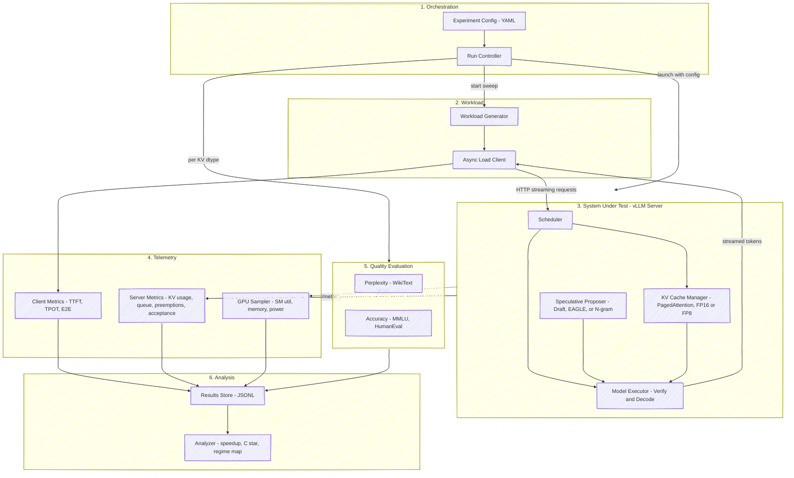

# Progress Report: Balancing Memory and Compute in LLM Serving

**Project Title:** Balancing Memory and Compute in LLM Serving (FP8 KV Cache Precision vs. Speculative Decoding Across Load)  
**Name:** Mridul Pant (`cs24mtech15009`)  
**GitHub Repository:** [llm_serving/src/llm_serving at main · mridulpant2010/llm_serving](https://github.com/mridulpant2010/llm_serving/tree/main/src/llm_serving)  
**Local Repository Path:** `C:\coding\llm_serving`

---

## A. Proposed Approach

### Problem and Goal
We study how two LLM serving optimizations interact as user concurrency ($C$) increases:
1. **Topic 2 (Memory - KV Cache Precision):** Switching KV cache precision from FP16 to FP8 halves per-token KV memory and doubles available KV blocks. We measure how much extra concurrency ($C_{\max}$) and throughput this actually gives before hitting a GPU compute bottleneck, along with any quality drop on WikiText-2 perplexity, MMLU, and HumanEval.
2. **Topic 3 (Compute - Speculative Decoding Across Load):** Speculative decoding (draft model, EAGLE, N-gram) speeds up generation at low batch sizes using spare GPU compute, but verifying draft tokens competes with normal request batching at high load. We measure the **crossover concurrency $C^*$** where speculative speedup $S(C) = \text{TPOT}_{\text{base}}(C) / \text{TPOT}_{\text{spec}}(C)$ drops below $1.0$, and how $C^*$ changes under FP8 vs. FP16 KV cache.

### Methodology and Justification
- **Controlled sweeps:** We run `Meta-Llama-3-8B-Instruct` on vLLM across concurrency $C \in [1, 256]$ and context lengths $[512, 8192]$, comparing FP16 vs. FP8 KV cache and `none`, `draft_model`, `eagle`, and `ngram` speculation.
- **Why this matters:** Most papers test KV quantization and speculative decoding separately (often at batch size 1). When FP8 and PagedAttention allow larger batch sizes, decoding becomes compute-bound faster, shrinking the load range where speculative decoding helps.

---

## B. System Design

### B.1 Architecture Overview

We treat the vLLM server as the **System Under Test (SUT)** and built the surrounding benchmarking, telemetry, and analysis harness in [llm_serving/src/llm_serving](https://github.com/mridulpant2010/llm_serving/tree/main/src/llm_serving).

### B.2 Code Modules (`src/llm_serving/`)

| Layer | Module File | Purpose |
| --- | --- | --- |
| 1. Baseline & Sim | [`kv_cache.py`](https://github.com/mridulpant2010/llm_serving/blob/main/src/llm_serving/kv_cache.py), [`paged_attention.py`](https://github.com/mridulpant2010/llm_serving/blob/main/src/llm_serving/paged_attention.py) | Local CPU KV cache profiler (FP32/FP16/INT8 size, MSE, perplexity, latency) and 16-token PagedAttention + Copy-on-Write simulator. |
| 1. Orchestration | [`config.py`](https://github.com/mridulpant2010/llm_serving/blob/main/src/llm_serving/config.py), [`orchestrator.py`](https://github.com/mridulpant2010/llm_serving/blob/main/src/llm_serving/orchestrator.py), [`cli.py`](https://github.com/mridulpant2010/llm_serving/blob/main/src/llm_serving/cli.py) | Parses [`configs/experiments.yaml`](https://github.com/mridulpant2010/llm_serving/blob/main/configs/experiments.yaml), groups runs by server launch, runs warm-ups and sweeps, saves to `results.jsonl` with `--resume`. |
| 2. Workload | [`workload.py`](https://github.com/mridulpant2010/llm_serving/blob/main/src/llm_serving/workload.py), [`load_client.py`](https://github.com/mridulpant2010/llm_serving/blob/main/src/llm_serving/load_client.py) | Generates exact token-ID prompts (`synthetic`, `corpus`, `sharegpt`, `shared_prefix`) and streams SSE completions at concurrency $C$. |
| 3. Server | [`server.py`](https://github.com/mridulpant2010/llm_serving/blob/main/src/llm_serving/server.py), [`mock_server.py`](https://github.com/mridulpant2010/llm_serving/blob/main/src/llm_serving/mock_server.py) | Manages `vllm` server lifecycle (`--kv-cache-dtype`, `--speculative-config`) and provides a local CPU `MockServer` for testing. |
| 4. Telemetry | [`telemetry.py`](https://github.com/mridulpant2010/llm_serving/blob/main/src/llm_serving/telemetry.py) | Scrapes vLLM Prometheus `/metrics` (KV blocks, waiting queue, preemptions, acceptance rate) and samples NVML GPU stats at 10 Hz. |
| 5. Quality | [`quality_eval.py`](https://github.com/mridulpant2010/llm_serving/blob/main/src/llm_serving/quality_eval.py) | Computes WikiText-2 perplexity via live server `prompt_logprobs=0` and runs `lm-eval-harness` (MMLU, HumanEval). |
| 6. Analysis | [`analysis.py`](https://github.com/mridulpant2010/llm_serving/blob/main/src/llm_serving/analysis.py), [`plotting.py`](https://github.com/mridulpant2010/llm_serving/blob/main/src/llm_serving/plotting.py) | Computes capacity tables, throughput knees, speedup $S(C)$, $\log_2(C)$ crossover $C^*$, and regime map plots. |

### B.3 Experiment Stages and Parameters (`configs/experiments.yaml`)

| Stage | Goal | Settings Swept |
| --- | --- | --- |
| Stage 1 (`stage1_kv_capacity`) | KV capacity & throughput scaling | `auto` (FP16) vs. `fp8`, no speculation, context `[512, 2048, 4096, 8192]`, $C \in [1, 256]$, `synthetic` prompts |
| Stage 2 (`quality`) | Accuracy vs. KV precision | WikiText-2 PPL, 5-shot MMLU, HumanEval (`pass@1`) for `auto` vs. `fp8` |
| Stage 3 (`stage3_spec_fp16`) | Speculative crossover $C^*$ on FP16 | `none`, `draft_model`, `eagle`, `ngram` ($k \in \{3, 5\}$) at context `2048`, $C \in [1, 128]$, `corpus` prompts |
| Stage 4 (`stage4_spec_fp8`) | Speculative crossover $C^*$ on FP8 | Same sweep as Stage 3 with `--kv-cache-dtype fp8` |
| Stage 5 (`stage5_prefix_ablation`) | Prefix caching ablation | `auto` vs. `fp8` with `--enable-prefix-caching` on `shared_prefix` prompts (50% shared system prompt) |

---

## C. Technical Feasibility and Engineering Fixes

- **Hardware and Tools:** My personal laptop is **CPU-only (no GPU)**, so all code development, GPT-2 profiling, PagedAttention simulations, and `MockServer` tests were run on CPU. Full vLLM sweeps (`Stages 1 to 5`, single server GPU per run with `tensor_parallel_size=1`) will run on the **college GPU server** using PyTorch, vLLM, `httpx`, `pynvml`, and `lm-eval-harness`.
- **Key Measurement Fixes Implemented in Code:**
  1. *Prefix caching bias:* Disabled prefix caching (`--no-enable-prefix-caching`) and used unshared random token IDs in Stage 1 so shared prefixes do not hide FP8 memory savings.
  2. *Speculative acceptance on random tokens:* Used real WikiText-2 slices (`CorpusWorkload`) in Stages 3 and 4 because N-gram and EAGLE get near-zero acceptance on random token noise.
  3. *Multi-token SSE chunks:* Computed TPOT from `usage.completion_tokens - 1` rather than SSE chunk count, since speculative decoding emits multiple tokens per chunk.
  4. *Concurrency limit detection:* Because vLLM queues/preempts requests instead of crashing with CUDA OOM, we record both analytic capacity $C_{\max}^{\text{analytic}} = \lfloor (N_{\text{blocks}} \times B) / (L_{\text{prompt}} + L_{\text{output}}) \rfloor$ and the first concurrency `first_pressure_C` where waiting requests or preemptions appear.
  5. *Live FP8 kernel perplexity:* Evaluated perplexity through the live vLLM server (`prompt_logprobs=0`) instead of offline HuggingFace so vLLM's actual FP8 PagedAttention kernels are tested.

---

## D. Implementation Plan, Local CPU Results, and Current Progress

**Code Repository:** [llm_serving/src/llm_serving at main · mridulpant2010/llm_serving](https://github.com/mridulpant2010/llm_serving/tree/main/src/llm_serving)

### D.1 What Has Been Implemented So Far (`src/llm_serving/`)

Because my laptop does not have a GPU, our work so far has focused on writing and testing the complete Python benchmarking, telemetry, and analysis codebase so it is ready to run on the college GPU server:

1. **KV Cache and PagedAttention Modules ([`kv_cache.py`](https://github.com/mridulpant2010/llm_serving/blob/main/src/llm_serving/kv_cache.py), [`paged_attention.py`](https://github.com/mridulpant2010/llm_serving/blob/main/src/llm_serving/paged_attention.py)):** Extracts KV cache tensors, calculates memory across FP32/FP16/INT8, computes per-layer quantization MSE, measures perplexity and batch latency, and simulates 16-token PagedAttention + Copy-on-Write blocks.
2. **Workload Generator and Async Streaming Client ([`workload.py`](https://github.com/mridulpant2010/llm_serving/blob/main/src/llm_serving/workload.py), [`load_client.py`](https://github.com/mridulpant2010/llm_serving/blob/main/src/llm_serving/load_client.py)):** Builds exact token-ID prompts (`synthetic`, `corpus`, `sharegpt`, `shared_prefix`) and streams SSE completions at concurrency $C$ to measure TTFT, TPOT, and E2E latency.
3. **Server Orchestration, Telemetry, and Quality Scripts ([`config.py`](https://github.com/mridulpant2010/llm_serving/blob/main/src/llm_serving/config.py), [`server.py`](https://github.com/mridulpant2010/llm_serving/blob/main/src/llm_serving/server.py), [`orchestrator.py`](https://github.com/mridulpant2010/llm_serving/blob/main/src/llm_serving/orchestrator.py), [`telemetry.py`](https://github.com/mridulpant2010/llm_serving/blob/main/src/llm_serving/telemetry.py), [`quality_eval.py`](https://github.com/mridulpant2010/llm_serving/blob/main/src/llm_serving/quality_eval.py), [`cli.py`](https://github.com/mridulpant2010/llm_serving/blob/main/src/llm_serving/cli.py)):** Manages YAML configs, vLLM server launches, Prometheus `/metrics` scraping, 10 Hz NVML GPU sampling, crash-safe `results.jsonl` logging (`--resume`), and server-side perplexity (`prompt_logprobs=0`) + `lm-eval-harness`.
4. **Analysis, Plotting, and Local Mock Testing ([`analysis.py`](https://github.com/mridulpant2010/llm_serving/blob/main/src/llm_serving/analysis.py), [`plotting.py`](https://github.com/mridulpant2010/llm_serving/blob/main/src/llm_serving/plotting.py), [`mock_server.py`](https://github.com/mridulpant2010/llm_serving/blob/main/src/llm_serving/mock_server.py)):** Computes capacity tables, throughput knees, speedup $S(C)$, $\log_2(C)$ crossover $C^*$, and regime maps, verified locally with 24 passing `pytest` tests (`tests/test_logic.py` and `tests/test_pipeline_mock.py`).

---

### D.2 Local CPU Baseline Results

The baseline results below were collected on my laptop CPU using `gpt2` (`124.4M` parameters, `torch.float32`, 12 layers, 12 heads, `head_dim = 64`) and our PagedAttention simulator. The full vLLM GPU server sweeps (`Stages 1 to 5`) are pending on the college server.

#### 1. KV Cache Precision Compression (6-Token Prompt)
- Raw FP32 KV cache size: `0.4219 MB (442,368 bytes)`

| Conversion | Original Size (MB) | Compressed Size (MB) | Memory Saved (%) |
| --- | --- | --- | --- |
| FP32 to FP16 | 0.4219 MB | 0.2109 MB | 50.0% |
| FP32 to INT8 | 0.4219 MB | 0.1056 MB | 75.0% |

#### 2. Per-Layer INT8 Quantization Error and Baseline Perplexity
- Baseline Perplexity on CPU evaluation text: `112.1526`

| Layer | Key MSE | Key MaxErr | Value MSE | Value MaxErr |
| --- | --- | --- | --- | --- |
| Layer 0 | 0.000282 | 0.0442 | 0.000028 | 0.0156 |
| Layer 1 | 0.000280 | 0.0439 | 0.000043 | 0.0209 |
| Layer 2 | 0.000150 | 0.0329 | 0.000072 | 0.0243 |
| Layer 3 | 0.000215 | 0.0398 | 0.000038 | 0.0189 |
| Layer 4 | 0.001275 | 0.0618 | 0.000043 | 0.0168 |
| Layer 5 | 0.000253 | 0.0419 | 0.000055 | 0.0199 |
| Layer 6 | 0.000251 | 0.0411 | 0.000048 | 0.0209 |
| Layer 7 | 0.000127 | 0.0315 | 0.000059 | 0.0211 |
| Layer 8 | 0.000122 | 0.0317 | 0.000083 | 0.0268 |
| Layer 9 | 0.000140 | 0.0292 | 0.000095 | 0.0265 |
| Layer 10 | 0.000110 | 0.0273 | 0.000108 | 0.0282 |
| Layer 11 | 0.000102 | 0.0289 | 0.000971 | 0.0882 |

#### 3. Context Length Scaling Sweep

| Context Length (tokens) | FP32 Cache (MB) | INT8 Cache (MB) |
| --- | --- | --- |
| 21 | 1.477 MB | 0.369 MB |
| 51 | 3.586 MB | 0.897 MB |
| 111 | 7.805 MB | 1.951 MB |
| 231 | 16.242 MB | 4.061 MB |
| 461 | 32.414 MB | 8.104 MB |

#### 4. CPU Batch Throughput and Single-Request Latency
- Single-request latency (`max_new_tokens=50`): `Tokens generated: 50`, `Total time: 3.828s`, `Time to first token (TTFT): 0.076s`, `Time per output token (TPOT): 76.6ms`, `Tokens/sec: 13.1`

| Batch Size (`max_new_tokens=20`) | Throughput (tok/s) | Total Time (s) |
| --- | --- | --- |
| Batch 1 | 12.3 tok/s | 1.63s |
| Batch 2 | 27.6 tok/s | 1.45s |
| Batch 4 | 49.5 tok/s | 1.62s |
| Batch 8 | 111.9 tok/s | 1.43s |
| Batch 16 | 191.6 tok/s | 1.67s |

#### 5. PagedAttention Memory Allocation Simulation

| Allocation Method | Results |
| --- | --- |
| Contiguous Reservation (4 requests, `max_seq_len=2048`, actual `[50, 120, 300, 10]`) | `Reserved Total Slots: 8192`, `Actual Tokens Generated: 480`, `Wasted Tokens (Internal Fragmentation): 7712`, `Memory Wasted: 94.1%` |
| PagedAttention (`User_0`, `block_size=16`, 50 tokens) | `Logical-to-Physical Block Table: [0, 1, 2, 3]`, `Tokens generated: 50`, `Internal Fragmentation (Wasted Slots): 14 tokens (21.9%)` |

---

### D.3 Summary of Completed, Ongoing, and Pending Tasks

| Task ID | Task Description | Status | Deliverable / Code Link |
| --- | --- | --- | --- |
| T0 | KV cache profiler, INT8 quantization error, baseline perplexity, and PagedAttention + CoW simulator | Completed | [`kv_cache.py`](https://github.com/mridulpant2010/llm_serving/blob/main/src/llm_serving/kv_cache.py), [`paged_attention.py`](https://github.com/mridulpant2010/llm_serving/blob/main/src/llm_serving/paged_attention.py), [`plotting.py`](https://github.com/mridulpant2010/llm_serving/blob/main/src/llm_serving/plotting.py) |
| T1 | Token-ID workload generator (`synthetic`, `corpus`, `sharegpt`, `shared_prefix`) and async streaming load client | Completed | [`workload.py`](https://github.com/mridulpant2010/llm_serving/blob/main/src/llm_serving/workload.py), [`load_client.py`](https://github.com/mridulpant2010/llm_serving/blob/main/src/llm_serving/load_client.py) |
| T2 | Client latency aggregator, vLLM Prometheus `/metrics` scraper, and 10 Hz NVML GPU sampler | Completed | [`telemetry.py`](https://github.com/mridulpant2010/llm_serving/blob/main/src/llm_serving/telemetry.py) |
| T3 | Staged YAML experiment config, vLLM server runner, crash-safe JSONL orchestrator with `--resume`, and CLI | Completed | [`config.py`](https://github.com/mridulpant2010/llm_serving/blob/main/src/llm_serving/config.py), [`server.py`](https://github.com/mridulpant2010/llm_serving/blob/main/src/llm_serving/server.py), [`orchestrator.py`](https://github.com/mridulpant2010/llm_serving/blob/main/src/llm_serving/orchestrator.py), [`cli.py`](https://github.com/mridulpant2010/llm_serving/blob/main/src/llm_serving/cli.py) |
| T4 | Server-side perplexity (`prompt_logprobs`) and `lm-eval-harness` (MMLU, HumanEval) wrapper | Completed | [`quality_eval.py`](https://github.com/mridulpant2010/llm_serving/blob/main/src/llm_serving/quality_eval.py) |
| T5 | Analyzer script for capacity tables, throughput knees, speedup $S(C)$, $\log_2(C)$ crossover $C^*$, and regime map plots | Completed | [`analysis.py`](https://github.com/mridulpant2010/llm_serving/blob/main/src/llm_serving/analysis.py), [`mock_server.py`](https://github.com/mridulpant2010/llm_serving/blob/main/src/llm_serving/mock_server.py) |
| T6 | Prepare `wikitext2_test.txt` and set up the college GPU server environment (`vllm`, `lm-eval`, `pynvml`) | Ongoing | Setting up Python environment and downloading `Meta-Llama-3-8B-Instruct`, draft, and EAGLE weights on the GPU server |
| T7 | Run Stages 1 to 5 on the college GPU server (`llm-serving run` and `llm-serving quality`) and generate final plots (`llm-serving analyze`) | Pending | GPU experimental runs (`results.jsonl`, `quality.jsonl`) and final regime map plots |
