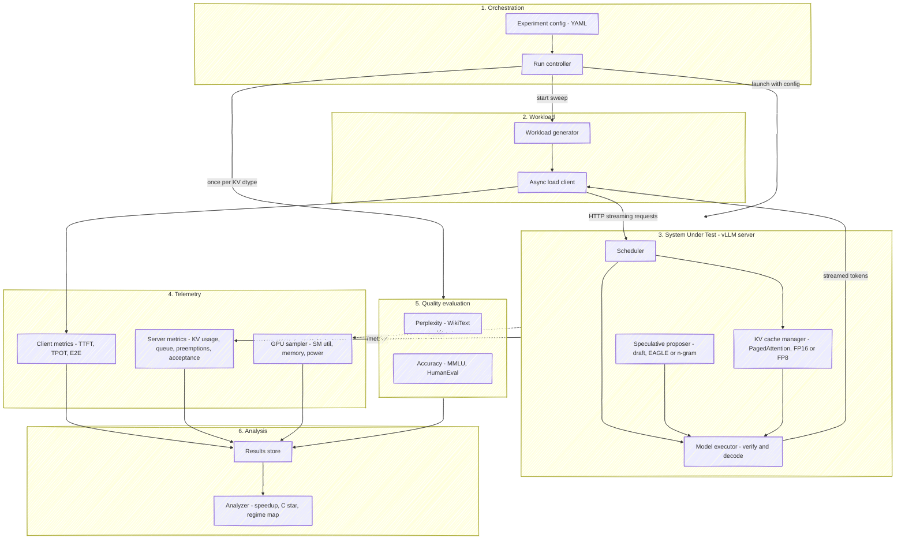
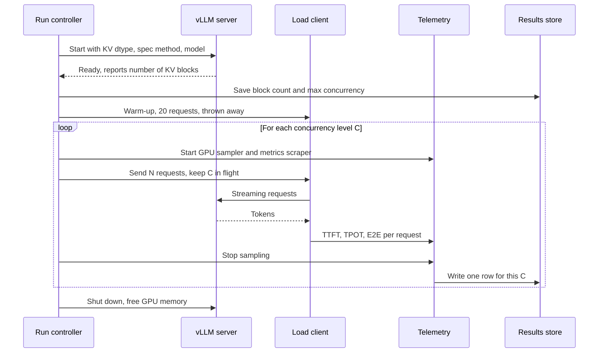
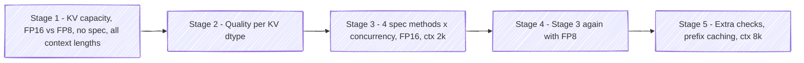

# Progress Report: Memory vs Compute in LLM Serving (FP8 KV Cache + Speculative Decoding)


```json
name: Mridul Pant
rollno: cs24mtech15009
```

## A. Proposed Approach

### What we are doing

There are two common tricks for serving LLMs faster:

- **FP8 KV cache**: store the KV cache in 8 bits instead of 16. This saves GPU memory, so more requests fit at the same time.
- **Speculative decoding**: a small, cheap model guesses the next few tokens, and the big model checks them all in one pass. This only helps when the GPU has spare compute.

These two pull against each other. FP8 lets us run bigger batches, and bigger batches use up the spare compute that speculative decoding depends on.

We are building a benchmark setup that runs both together while changing the number of concurrent requests and the context length. The main thing we want to find is **$C^*$**, the concurrency level after which speculative decoding stops helping and starts making latency worse. We also want to see how $C^*$ moves when we switch the KV cache from FP16 to FP8.

### How we will do it

We measure on a real server instead of relying on a model or formula, and we change one thing at a time.

1. **Memory side (Topic 2):** run the same model with an FP16 KV cache and then an FP8 one. For each, record:
   - how many KV blocks vLLM allocates, and how many requests that allows
   - the throughput we actually get as load goes up
   - the quality loss (perplexity, MMLU, HumanEval)
2. **Compute side (Topic 3):** run with no speculation, a draft model, EAGLE, and n-gram, over the same concurrency levels. Record TPOT, acceptance rate and GPU utilization.
3. **Combine the two:** for each KV precision, compute the speedup

   $$S(C) = \frac{\text{TPOT}_{\text{base}}(C)}{\text{TPOT}_{\text{spec}}(C)}$$

   $C^*$ is the point where $S(C^*) = 1$. We plot this as a regime map.

### Why this is worth doing

- vLLM and SGLang both let you turn on FP8 KV cache and speculative decoding together.
- Most published results test each feature on its own, and speculative decoding is usually tested at small batch sizes.
- GPU memory and compute are both fixed. When PagedAttention and FP8 let the batch grow, the GPU does more math per byte loaded, and the idle compute that speculation relies on disappears.
- Nobody has clearly measured how the two interact under real load. That is what this project measures.

---

## B. System Design

### B.1 Architecture

The setup has six layers. vLLM itself is the **System Under Test (SUT)**: we configure it and watch it, but we don't change its code. Everything around it is our code.



### B.2 Components

| Layer | Component | What it does | Code |
|---|---|---|---|
| 1 | Experiment config | Lists what we vary (KV dtype, speculation method, concurrency, context length) and what we keep fixed (model, weight format, `max_model_len`, `gpu_memory_utilization`, seed). | `configs/experiments.yaml` (planned) |
| 1 | Run controller | For each config: start vLLM, wait until healthy, warm up, run the sweep, collect metrics, shut down, free GPU memory. Saves the KV block count at startup. Retries or skips configs that fail. | `orchestrator.py` (planned, from `run_benchmark.py`) |
| 2 | Workload generator | Builds requests. Synthetic fixed-length prompts with random tokens (so no two prompts share a prefix) for context sweeps. ShareGPT samples for realistic lengths. | `workload.py` (planned) |
| 2 | Async load client | Keeps exactly C requests in flight (closed loop), or sends them at Poisson arrival times (open loop). Uses streaming so each token gets a timestamp. | `load_client.py` (planned) |
| 3 | Scheduler (vLLM) | Accepts new requests while free KV blocks exist. Queues or preempts them when the pool is full. | part of vLLM |
| 3 | KV cache manager (vLLM) | PagedAttention block pool, sized once at startup. With `kv_cache_dtype=fp8` each token takes half the space, so roughly 2x the tokens fit. | part of vLLM; same idea simulated in `paged_attention.py` |
| 3 | Speculative proposer (vLLM) | Guesses k tokens per step (draft model, EAGLE head, or n-gram lookup). The target model checks all of them in one forward pass. | part of vLLM |
| 4 | Client metrics | Per request: TTFT, TPOT, end-to-end latency. Reported as p50/p90/p99. | `telemetry.py` (planned) |
| 4 | Server metrics | Reads vLLM's `/metrics` endpoint: KV cache usage %, running and waiting requests, preemptions, draft and accepted token counts. | `telemetry.py` (planned) |
| 4 | GPU sampler | Background thread reading SM utilization, memory and power through `pynvml` every 100 ms. | `telemetry.py` (planned) |
| 5 | Quality evaluator | Perplexity on WikiText-2 and accuracy on MMLU and HumanEval (via `lm-eval-harness`), once per KV dtype. Quality does not depend on load, so it runs outside the sweep. | `kv_cache.measure_perplexity` (done), `quality_eval.py` (planned) |
| 6 | Analyzer | Joins all results, plots throughput curves and $S(C)$, finds $C^*$ by interpolation, draws the regime map. | `plotting.py` (done), to be extended into `analysis.py` |

### B.3 What happens in one run



### B.4 Experiment matrix

Running every combination would take 2 × 4 × 9 × 4 = 288 runs, which is too many. So we run it in stages:



| What | Values |
|---|---|
| KV cache dtype | `auto` (FP16/BF16), `fp8` |
| Speculation | none, draft model, EAGLE, n-gram |
| Concurrency C | 1, 2, 4, 8, 16, 32, 64, 128, 256 |
| Context length | 512, 2048, 4096, 8192 |
| Kept fixed | Llama-3-8B-Instruct, weight format, 256 output tokens, `gpu_memory_utilization=0.9`, prefix caching off (except Stage 5), greedy decoding, fixed seed |

### B.5 Inputs and outputs

**Inputs**
- Target model weights, plus draft or EAGLE weights where needed
- Experiment config
- Prompt data: synthetic random-token prompts, ShareGPT, WikiText-2, MMLU, HumanEval

**Outputs**

| Output | Question it answers |
|---|---|
| KV block count and max concurrency for each (dtype, context length) | How much extra concurrency does FP8 give? |
| Throughput vs C, FP16 vs FP8 | Does that extra concurrency become more tokens/s, or does compute become the limit? |
| Change in perplexity, MMLU, HumanEval (FP8 minus FP16) for each context length | How much quality do we lose, and where does it start to show? |
| TPOT p50/p99 vs C for each spec method, with acceptance rate and SM utilization | How fast does the benefit of speculation drop as load goes up? |
| $S(C)$ curves and $C^*$ for each (method, KV dtype) | Where is the crossover? |
| Regime map | When should we optimize for memory, and when for latency? |

### B.6 Measuring max concurrency

vLLM reserves its whole KV pool at startup, so it does not run out of memory as load grows. When the pool is full it queues or preempts requests instead. So we can't find the limit by waiting for an OOM. We measure it two ways, and the two should agree:

1. **From the block count:**

   $$C_{\max} = \frac{N_{\text{blocks}} \times 16}{L_{\text{prompt}} + L_{\text{output}}}$$

   Here 16 is the number of tokens per block, and $N_{\text{blocks}}$ is the count vLLM prints at startup.
2. **From the metrics:** the smallest C where the waiting queue or the preemption count goes above zero.

The OOM-based sweep in `kv_cache.py` (plain HuggingFace, no PagedAttention) is still useful for learning on a laptop.

---

## C. Technical Feasibility

### Tools and data

- **Serving:** vLLM (OpenAI-compatible server, PagedAttention, `--kv-cache-dtype fp8`, speculative decoding via `speculative_config`)
- **Local testing:** PyTorch, HuggingFace `transformers`, Jupyter
- **Telemetry:** `httpx`/`aiohttp` for the async client, `pynvml`, parsing Prometheus text
- **Quality:** `lm-eval-harness` (MMLU, HumanEval), WikiText-2 perplexity
- **Analysis:** pandas, matplotlib
- **Hardware:** laptop or Colab for development, college GPU server (ideally L40S or H100) for the final runs

### Is it doable?

Yes. Everything outside vLLM is normal Python, and vLLM already has both features built in. The main risk is getting the right GPU, not the code.

### Problems, assumptions and limits

1. **FP8 needs newer GPUs.** Native FP8 math needs Ada or Hopper. On an A100, vLLM still stores the cache in FP8, so we still see the memory saving, but there is no compute speedup. We will note which GPU we used.
2. **vLLM keeps changing.** Speculative decoding options have changed between releases, so we will fix one vLLM version for the whole project.
3. **EAGLE weights.** An EAGLE head has to exist for the target model. This is one reason we chose Llama-3-8B-Instruct.
4. **Noisy numbers.** We do warm-up runs, repeat each point 3 times, and report the median with spread.
5. **Assumption:** greedy decoding and synthetic prompts are close enough to real traffic. The ShareGPT runs partly check this.
6. **Limit:** single GPU only. No tensor parallelism.

---

## D. Implementation Plan

### Done

- `kv_cache.py`: KV cache extraction, memory profiling, INT8 simulation, per-layer quantization error, perplexity, latency and batch sweeps with HuggingFace
- `paged_attention.py`: a small PagedAttention simulator for learning (block tables, on-demand allocation, shared blocks with reference counts, copy-on-write)
- `plotting.py`: plots for cache size vs context, throughput vs concurrency, and quantization error
- `run_benchmark.py`: first offline benchmark with vLLM (will be turned into the run controller)
- Notebooks `01` and `02`: local experiments with GPT-2. Baseline perplexity: 112.15

### In progress

- Turning `run_benchmark.py` into a server-based run controller
- Fixing the benchmark so prompts are not identical, which stops prefix caching from hiding the FP8 effect

### To do

| Task | What gets built | Result |
|---|---|---|
| T1 | `workload.py` + `load_client.py` | Fixed concurrency with a timestamp for each token |
| T2 | `telemetry.py` | Client, server and GPU metrics in one place for each run |
| T3 | `orchestrator.py` + `experiments.yaml` | Runs all stages without someone watching |
| T4 | `quality_eval.py` | Quality difference between FP16 and FP8 |
| T5 | `analysis.py` | Throughput curves, $S(C)$, $C^*$, regime map |
| T6 | Server runs, Stages 1 to 5 | Final data and plots for the report |

### Next steps

1. Build T1 to T3 and test them end to end on Colab with TinyLlama and n-gram speculation (n-gram needs no extra weights).
2. Get GPU server access, fix the vLLM version, and run Stages 1 and 2.
3. Run Stages 3 and 4, compute $C^*$, and make the regime map.
4. Go over the results with our mentor, then run the Stage 5 checks.
