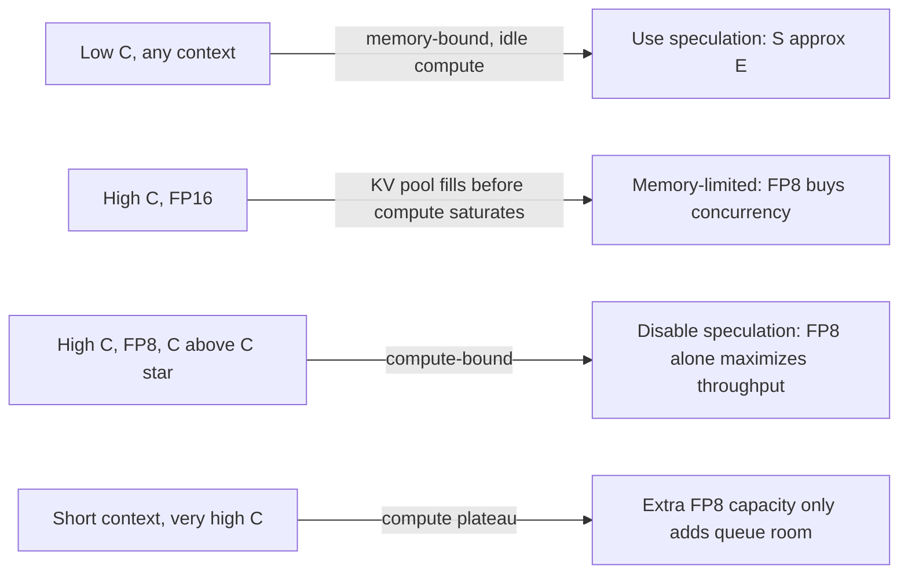

# System Design from First Principles (with Worked Examples)

This document explains the design in [progress_report_design.md](progress_report_design.md) from the bottom up. Each section starts with a law that cannot be argued with (bytes, FLOPs, bandwidth, probability), shows how that law produces a design decision, and works through the numbers.

> **About the numbers.** The examples use an idealized model: **Llama-3-8B** on one **H100-80GB**, with *effective* bandwidth of 3.0 TB/s and *effective* compute of 500 TFLOPS. The goal is to show *why* the curves look the way they do. The real values are what the harness measures. Real crossover points will be **lower** than the ones computed here, because the idealized model ignores draft-model cost, scheduler overhead and kernel inefficiency.

---

## 0. The One-Paragraph Version

An LLM generates text one token per forward pass ("decode step"). Each step has to **read all the model weights and the KV cache of every active request** from GPU memory. At small batch sizes the GPU spends most of its time waiting on memory, so its arithmetic units sit idle.
- **FP8 KV cache** halves the bytes per cached token. That means more requests fit (**higher concurrency**) and fewer bytes are read per step.
- **Speculative decoding** fills the idle arithmetic units by checking *k* guessed tokens in one pass.

Both draw on the same idle-compute budget. FP8 lets the batch grow until compute is no longer idle, and at that point speculation stops helping. The concurrency where it *starts to hurt* is **$C^*$**. The harness exists to measure $C^*$ and how FP8 moves it.

---

## 1. First Principle: The KV Cache Is Just Bytes

### 1.1 Why a KV cache exists
In attention, token $t$ needs the keys and values of all previous tokens $1..t-1$:

$$\text{Attn}(q_t) = \sum_{i \le t} \text{softmax}_i\!\left(\frac{q_t \cdot k_i}{\sqrt{d}}\right) v_i$$

$k_i$ and $v_i$ never change once computed, so we store them instead of recomputing them every step. That storage is the KV cache.

### 1.2 Bytes per token
For each token, each layer stores one K vector and one V vector per KV head:

$$\text{bytes/token} = 2 \times L_{\text{layers}} \times H_{kv} \times d_{\text{head}} \times \text{bytes/element}$$

**Example (Llama-3-8B: 32 layers, 8 KV heads with GQA, head dim 128):**

| Precision | Calculation | Bytes per token |
|---|---|---|
| FP16 | $2 \times 32 \times 8 \times 128 \times 2$ | **131,072 B = 128 KiB** |
| FP8 | $2 \times 32 \times 8 \times 128 \times 1$ | **65,536 B = 64 KiB** |

One 2,048-token request needs $2048 \times 128\text{ KiB} = 256\text{ MiB}$ in FP16 and only 128 MiB in FP8.

### 1.3 How big the KV pool is
vLLM sizes the pool **once at startup**:

$$\text{KV pool} = \underbrace{0.9 \times 80}_{\text{gpu\_memory\_utilization}} - \underbrace{16}_{\text{weights}} - \underbrace{\sim 2}_{\text{activations, CUDA graphs}} \approx 54 \text{ GB}$$

| | FP16 | FP8 |
|---|---|---|
| Tokens that fit | $54\times10^9 / 131072 \approx 411{,}987$ | $\approx 823{,}974$ |
| Blocks (16 tokens each) | **25,749** | **51,498** |

**Design consequence → Run Controller.** The block count is fixed at launch, so the Run Controller reads `num_gpu_blocks` from the server right after startup and saves it ([telemetry.py](src/llm_serving/telemetry.py) `get_cache_info`). This is the "analytical" half of the capacity measurement.

---

## 2. First Principle: Memory Allocation (Why PagedAttention)

### 2.1 The fragmentation problem
Older servers reserved one contiguous slab of `max_model_len` tokens per request, because they could not know the final length in advance.

**Example:** `max_model_len = 2048`, and a request actually uses 300 tokens.
- Contiguous: 2048 slots reserved, 300 used → **85% wasted**.
- Paged (block = 16): $\lceil 300/16 \rceil = 19$ blocks = 304 slots → **4 slots wasted (1.3%)**.

Waste is limited to the last, partly filled block: at most $B-1 = 15$ tokens per request.

### 2.2 Block tables: virtual memory for the KV cache
Each request has a **logical** sequence of blocks. A **block table** maps them to **physical** blocks, which can sit anywhere in the pool:

```
Request A  logical: [0][1][2]        block table: 0→7, 1→2, 2→19
Request B  logical: [0][1]           block table: 0→4, 1→11
Physical pool: [ ][ ][A1][ ][B0][ ][ ][A0][ ][ ][ ][B1] ... [A2]
```

A new block is allocated only when the current one fills up, i.e. once every 16 generated tokens.

### 2.3 Sharing and copy-on-write
**Example:** parallel sampling with `n = 4` from a 1,000-token prompt.
- Without sharing: $4 \times \lceil 1000/16 \rceil = 4 \times 63 = 252$ blocks.
- With sharing: all 4 sequences point at the same 63 blocks (reference count = 4). Block 62 is only partly full ($1000 - 62\times16 = 8$ tokens). On the first divergent write, 3 of the sequences each copy that block → $63 + 3 = 66$ blocks (**−74%**).

### 2.4 Preemption instead of OOM
When the pool runs out, vLLM does **not** crash. It either:
- **Recomputes:** frees the request's blocks and re-runs prefill later. Cost ≈ $1152 \times 16\text{ GFLOP} / 500\text{ TFLOPS} \approx 37$ ms for a 1,152-token request.
- **Swaps:** copies the blocks to CPU RAM. $1152 \times 128\text{ KiB} \approx 151$ MB over PCIe 4.0 (~25 GB/s) ≈ 6 ms each way.

**Design consequences:**
1. **Capacity is measured, not crashed into.** The empirical ceiling is the lowest $C$ where `num_requests_waiting > 0` or `num_preemptions_total` rises (Server Metrics Scraper). The analytical ceiling is

$$C_{\max} = \frac{N_{\text{blocks}}}{\lceil (L_{\text{prompt}} + L_{\text{output}}) / 16 \rceil}$$

**Example** with prompt 896 + output 256 = 1,152 tokens = 72 blocks:

| | FP16 | FP8 |
|---|---|---|
| $C_{\max}$ | $25{,}749 / 72 = $ **357** | $51{,}498 / 72 = $ **715** |

2. **Prefix caching is OFF by default.** With identical prompts, sharing (§2.3) would collapse every request onto the same blocks. Memory use would then barely depend on the KV dtype, and the FP8 effect would vanish. That is why the [Workload Generator](src/llm_serving/workload.py) uses **random-token prompts**, and why prefix caching appears only in the Stage 5 ablation.

You can try all of this in [02_paged_attention_tutorial.ipynb](notebooks/02_paged_attention_tutorial.ipynb), which uses [paged_attention.py](src/llm_serving/paged_attention.py).

---

## 3. First Principle: The Roofline (Why Decode Is Memory-Bound)

### 3.1 Two clocks
A GPU kernel is limited by whichever takes longer, moving the bytes or doing the math:

$$T_{\text{step}} \approx \max\!\left(\frac{\text{bytes moved}}{\text{BW}},\ \frac{\text{FLOPs}}{F}\right)$$

The **arithmetic intensity** $I = \text{FLOPs}/\text{byte}$ tells you which one wins. The ridge point of the GPU is $F / \text{BW} = 500\text{T}/3.0\text{T} \approx 167$ FLOP/byte.

### 3.2 Decode step cost for batch $B$, verifying $w$ tokens per sequence
- **Weights:** read **once per step**, no matter how large $B$ is: $16\text{ GB}/3.0\text{ TB/s} = 5.33$ ms.
- **KV cache:** each sequence's cache is read once: $B \times \text{ctx} \times \text{bytes/token}$.
- **Compute:** $\approx 2N = 16$ GFLOP per token → $16\text{G}/500\text{T} = 0.032$ ms per token, times $B \cdot w$ tokens.

With an average context of 1,024 tokens:

| Term | FP16 | FP8 |
|---|---|---|
| $T_{\text{mem}}(B)$ | $5.33 + 0.0447B$ ms | $5.33 + 0.0224B$ ms |
| $T_{\text{comp}}(B, w)$ | $0.032\,B\,w$ ms | same |

Weight GEMM intensity is $\approx 2NB / 2N = B$ FLOP/byte. At $B = 1$ the GPU runs at about $1/167$ of its compute peak. **Decode at low batch leaves more than 99% of the compute idle.** This is the "spare compute" both optimizations compete for.

**Design consequence → GPU Sampler.** SM utilization from NVML is logged, so we can see directly whether a run was memory-bound or compute-bound.

---

## 4. First Principle: Speculative Decoding Is a Bet on Idle Compute

### 4.1 Mechanism
A cheap proposer (draft model, EAGLE head, or n-gram lookup) guesses $k$ tokens. The target model scores all $k+1$ positions in **one** forward pass ($w = k+1$). It accepts the longest prefix that matches. Rejection sampling (or exact argmax matching under greedy decoding) guarantees the output **distribution is unchanged**: speculation is lossless.

### 4.2 Expected tokens per step
If each draft token is accepted independently with probability $\alpha$, token $i$ survives only if tokens $1..i$ all do, which happens with probability $\alpha^i$:

$$E[\text{tokens/step}] = \sum_{i=0}^{k} \alpha^i = \frac{1 - \alpha^{k+1}}{1 - \alpha}$$

**Example** ($k = 4$, $\alpha = 0.7$): $1 + 0.7 + 0.49 + 0.343 + 0.240 = $ **2.77 tokens per step**.

### 4.3 The speedup ratio
$$S(B) = E \times \frac{T_{\text{step}}(B, 1)}{T_{\text{step}}(B, k+1)}$$

- **Small $B$:** both steps are memory-bound, so they take the same time. $S \approx E = 2.77$. The extra $k$ tokens of verification are free.
- **Large $B$:** the spec step becomes compute-bound ($0.16B$ ms with $w = 5$). Its time grows 5× faster, while it still yields only 2.77 tokens. $S$ falls below 1, and **$C^*$** is where $S = 1$.

The spec step turns compute-bound when $0.16B > T_{\text{mem}}(B)$:
- FP16: $0.16B = 5.33 + 0.0447B \Rightarrow B \approx 46$
- FP8: $0.16B = 5.33 + 0.0224B \Rightarrow B \approx 39$

### 4.4 Solving for $C^*$
Set $E \cdot T_{\text{mem}}(B) = 0.16B$:

| | Equation | $C^*$ | $C_{\max}$ | Verdict |
|---|---|---|---|---|
| FP16 | $2.77(5.33 + 0.0447B) = 0.16B$ | **≈ 412** | 357 | Memory runs out **before** the crossover. Speculation never hurts within feasible load. |
| FP8 | $2.77(5.33 + 0.0224B) = 0.16B$ | **≈ 151** | 715 | Crossover lies **inside** the feasible region. Speculation hurts above ~151. |

### 4.5 The full curve

| $B$ | $S$ FP16 | $S$ FP8 |
|---|---|---|
| 1 | 2.77 | 2.77 |
| 32 | 2.77 | 2.77 *(still memory-bound)* |
| 64 | 2.22 | 1.83 |
| 128 | 1.50 | 1.11 |
| 151 | 1.37 | **1.00 ← $C^*$** |
| 256 | 1.14 | 0.75 |
| 357 | 1.03 *(FP16 $C_{\max}$)* | 0.61 |

**This is the core thesis in one table.** FP8 makes the per-sequence memory cost cheaper, so the step stays "memory-light" while compute grows. That pulls the spec step into the compute-bound regime at a lower batch, and it also *allows* a batch large enough to get there.

**Worked check at $B = 128$, FP8:** $T_{\text{mem}} = 5.33 + 2.86 = 8.20$ ms. $T_{\text{spec}} = \max(8.20, 20.48) = 20.48$ ms. $S = 2.77 \times 8.20 / 20.48 = 1.11$. ✓

**Design consequences:**
- The [mock server](src/llm_serving/mock_server.py) uses exactly this shape: `step = T_MEM + T_COMPUTE * B * (1+k)`. That is why tuning `T_COMPUTE` was needed to make the mock cross over at C = 128.
- **Acceptance rate is logged** (`spec_decode_num_accepted_tokens_total / num_draft_tokens_total`), because $E$, and therefore $C^*$, depends heavily on $\alpha$. N-gram ($\alpha \approx 0.35$, $E \approx 1.5$) crosses far earlier than EAGLE ($\alpha \approx 0.8$, $E \approx 3.4$).

---

## 5. First Principle: Concurrency, Throughput and Little's Law

### 5.1 Closed-loop load
The [Async Load Client](src/llm_serving/load_client.py) keeps **exactly $C$ requests in flight**: when one finishes, the next starts. That pins the server's batch size $B \approx C$, which is the variable that §3–4 depend on.

**Little's Law:** $\text{throughput} = C / \text{latency}$.

**Example (FP16, C = 64):** $T_{\text{step}} = 8.20$ ms. A 256-token output takes $256 \times 8.20 \approx 2.10$ s plus TTFT ≈ 0.1 s, so 2.2 s in total.
Throughput = $64 / 2.2 = 29$ req/s × 256 tokens ≈ **7,450 tok/s**.

### 5.2 Does the extra concurrency turn into throughput?
Base decode throughput is $B / T_{\text{mem}}(B)$:

| | FP16 | FP8 |
|---|---|---|
| $B = 256$ | 256 / 16.79 ms = **15.2k tok/s** | 256 / 11.06 ms = **23.1k tok/s** |
| At $C_{\max}$ | 357 / 21.3 ms = **16.8k tok/s** | 715 / 21.3 ms = **33.6k tok/s** |

FP8 gives 2× the concurrency and ~2× the throughput here. **But** with short contexts the KV term shrinks, compute ($0.032B$) catches up, and throughput **plateaus** before $C_{\max}$. For a 128-token context: $0.032B = 5.33 + 0.0056B \Rightarrow B \approx 202$. Beyond that, extra concurrency from FP8 buys queueing capacity, not tokens per second. This is why the matrix sweeps **context length**.

### 5.3 Why streaming and percentiles
- **TTFT** = time to first chunk (prefill + queueing). **TPOT** = (E2E − TTFT)/(tokens − 1). Measuring them separately requires per-chunk timestamps, which is why the client streams.
- Token counts come from the server's `usage` field, because speculation emits **several tokens per chunk** (verified in `test_load_client_measures_ttft_tpot_and_counts_tokens_from_usage`).
- p99 matters because preemption hits a few unlucky requests hard. The mean hides that.

---

## 6. First Principle: Quality Cost of FP8

### 6.1 What FP8 rounding does
E4M3 has 3 mantissa bits, so values in $[2^e, 2^{e+1})$ are spaced $2^{e-3}$ apart. Maximum relative rounding error is $2^{-4} = 6.25\%$. A per-tensor scale $s = \max|x| / 448$ maps the tensor into range.

**Example:** $x = 0.37$ lies in $[0.25, 0.5)$, so the spacing is $0.25/8 = 0.03125$. The neighbours are 0.34375 and 0.375 → stored as **0.375** (error 1.4%).

### 6.2 Why it shows up in attention
An error $\delta$ in a logit $q \cdot k / \sqrt{d}$ multiplies that token's attention weight by $e^{\delta}$. Errors in **K** distort *where* the model attends. Errors in **V** distort *what* it reads. Longer contexts mean more perturbed terms and more chances for an outlier key to steal attention mass. That is why quality is measured **per context length**.

### 6.3 Perplexity
$$\text{PPL} = \exp\!\left(-\frac{1}{N}\sum_{t} \log p(x_t \mid x_{<t})\right)$$

**Example:** your GPT-2 baseline PPL is 112.15, so the mean NLL is $\ln 112.15 = 4.720$. If FP8 raises the mean NLL by 0.005, then PPL = $e^{4.725} = 112.71$ (**+0.5%**).

**Design consequence → Quality Layer runs outside the sweep.** Rounding error depends on the dtype, not on load, so quality is computed **once per KV dtype** ([quality_eval.py](src/llm_serving/quality_eval.py)). It runs *through the same server* via `prompt_logprobs`, so the FP8 cache actually in use is the one being tested.

---

## 7. First Principle: Valid Experiments (Why the Orchestration Looks Like This)

| Principle | Design response |
|---|---|
| Change one factor at a time | Staged matrix (Stages 1→5) instead of 288 blind runs ([experiments.yaml](configs/experiments.yaml)) |
| Remove confounds | Random-token prompts, prefix caching OFF, fixed seed and output length, greedy decoding |
| Cold-start effects (CUDA graphs, allocator) | Warm-up requests discarded before every sweep |
| Noise | 3 repetitions per point, median plus spread |
| Long unattended runs crash | JSONL results with **resume**: finished (config, C) points are skipped on restart (tested) |
| Mock data must never be mistaken for real data | Rows tagged `backend: "mock"`, banner in the report |

### 7.1 Finding $C^*$ from discrete measurements
We only measure at $C \in \{1, 2, 4, \dots, 256\}$, so the analyzer finds the two points that bracket $S = 1$ and interpolates on $\log_2 C$.

**Example (FP8 values from §4.5):** $S(128) = 1.11$ and $S(256) = 0.75$.

$$\log_2 C^* = 7 + \frac{1.11 - 1}{1.11 - 0.75} = 7.31 \Rightarrow C^* \approx 2^{7.31} \approx 158$$

The true value is 151. This ~5% interpolation error is why Stage 4 can add **intermediate concurrency points** (e.g. 96, 160, 192) around a detected crossover.

### 7.2 Server counters → rates
Prometheus counters only ever increase, so the scraper takes **deltas** over the measurement window:

$$\alpha_{\text{measured}} = \frac{\Delta\,\text{accepted\_tokens}}{\Delta\,\text{draft\_tokens}} = \frac{56{,}000 - 28{,}000}{80{,}000 - 40{,}000} = 0.70$$

---

## 8. Putting It Together: The Regime Map



| What you measure | What first principle explains it |
|---|---|
| FP8 doubles `num_gpu_blocks` | §1.2 bytes/token halve |
| Waiting queue appears at $C \approx C_{\max}$ | §2.4 fixed pool + preemption |
| Throughput gain < 2× at short context | §5.2 compute plateau |
| $S(C)$ declines with $C$ | §4.3 verification turns compute-bound |
| $C^*_{\text{FP8}} < C^*_{\text{FP16}}$ | §4.4 cheaper KV reads + larger feasible batch |
| ΔPPL grows with context | §6.2 more perturbed attention terms |

---

## 9. Map to Code

| Section | Code |
|---|---|
| §1 Bytes / pool size | [telemetry.py](src/llm_serving/telemetry.py) (`get_cache_info`), [kv_cache.py](src/llm_serving/kv_cache.py) |
| §2 Paging / CoW / preemption | [paged_attention.py](src/llm_serving/paged_attention.py), notebook 02 |
| §3–4 Roofline + speculation | [mock_server.py](src/llm_serving/mock_server.py) (toy model), [server.py](src/llm_serving/server.py) (real vLLM) |
| §5 Load and latency | [load_client.py](src/llm_serving/load_client.py), [workload.py](src/llm_serving/workload.py) |
| §6 Quality | [quality_eval.py](src/llm_serving/quality_eval.py) |
| §7 Orchestration + $C^*$ | [orchestrator.py](src/llm_serving/orchestrator.py), [analysis.py](src/llm_serving/analysis.py), [config.py](src/llm_serving/config.py) |
